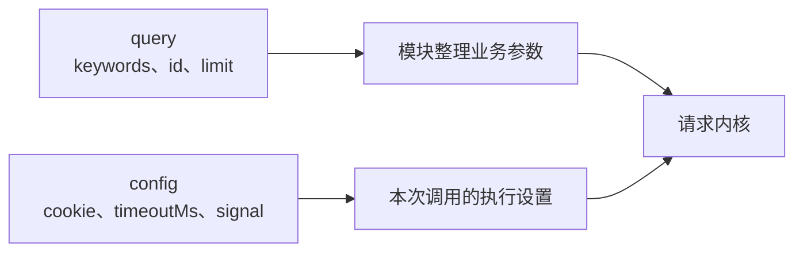

# 编程式调用

SDK 的常用入口有三个：创建 client、导入具名函数、按模块名调用。它们都返回 Promise，业务参数和执行配置分开传。

## 连续调用多个接口

`createHanaMusicApi` 将一组默认配置绑定到 client。适合共享 Cookie、缓存或自定义 `fetcher` 的场景。

```ts
import { createHanaMusicApi } from 'hana-music-api';

const hana = createHanaMusicApi({
  cookie: 'MUSIC_U=your-cookie',
  timeoutMs: 8000,
});

const searchResult = await hana.search({ keywords: '周杰伦', limit: 5 });
const songResult = await hana.songUrl({ id: '347230', br: 320000 });

console.log(searchResult.body, songResult.body);
```

方法的第二个参数覆盖这次调用的默认配置。覆盖按字段进行，比如传入新的 `headers` 对象会替换原来的 `headers`，不会递归合并对象里的每个字段。

```ts
await hana.search({ keywords: '林俊杰' }, { timeoutMs: 5000 });
```

## 只调用少量接口

可以直接导入具名函数。名称采用 camelCase，例如 HTTP 的 `/song/url` 对应 `songUrl`：

```ts
import { songUrl } from 'hana-music-api';

const result = await songUrl(
  { id: '347230' },
  { cookie: 'MUSIC_U=your-cookie' },
);

console.log(result.body);
```

这里导入的是公开的 Promise 包装函数。仓库 `src/modules/` 里的默认导出是内部 Effect 实现，不是下游应直接导入的 SDK 函数。

## 按模块名调用

模块名在运行时选择时，用 `invokeModule(identifier, query, config)`。模块标识采用下划线形式，TypeScript 中用 `ModuleIdentifier` 表示受支持的名称集合。

```ts
import { invokeModule } from 'hana-music-api';

const result = await invokeModule(
  'user_account',
  {},
  { cookie: 'MUSIC_U=your-cookie' },
);

console.log(result.body);
```

## 业务参数和执行配置



`query` 的类型来自模块自己的输入声明。`config` 使用 `ModuleCallConfig`，完整字段见 [配置参考](/guide/config-reference)。HTTP 能接收的字段更少，见 [调用约定](/guide/request-convention)。

## 返回值与错误

### 响应形状

client 的方法、具名函数、`invokeModule` 和 `createRequest` 都返回 Promise。成功和失败时拿到的都是同样的三字段对象，类型是公开导出的 `NcmApiResponse`：

| 字段     | 含义                                                       |
| -------- | ---------------------------------------------------------- |
| `status` | 请求层或模块整理后的状态码，不一定等于上游原始 HTTP 状态码 |
| `body`   | 接口正文，可能包含业务 `code`，普通响应保留未知 JSON       |
| `cookie` | 上游下发的 Cookie 字符串数组                               |

### 成功与失败的区分

**失败时 Promise reject，成功时 resolve**，但两者都是上面的对象形状。抛出的不是 `Error` 实例（`instanceof Error` 为 `false`），不能只读 `error.message`。

少数模块可能 **resolve 非 2xx 状态**。例如歌单封面更新在参数冲突或缺失时 resolve `status: 400`，榜单查询不支持特定调用方式时 resolve `status: 500`。调用方要在 `await` 后检查 `status`，不能假设 resolve 就是 200。

```ts
import { search, type NcmApiResponse } from 'hana-music-api';

// 类型守卫：检查是否为 SDK 的标准响应对象
function isNcmApiResponse(error: unknown): error is NcmApiResponse {
  return (
    typeof error === 'object' &&
    error !== null &&
    'status' in error &&
    'body' in error &&
    'cookie' in error
  );
}

try {
  const result = await search({ keywords: '海阔天空' });
  if (result.status !== 200) {
    console.error('调用成功但状态非 200:', result.status, result.body);
  } else {
    console.log(result.body);
  }
} catch (error: unknown) {
  if (isNcmApiResponse(error)) {
    console.error('调用失败:', error.status, error.body);
  } else {
    // 不应该到这里，除非是意外的运行时错误
    throw error;
  }
}
```

### 失败情况与状态码

| 情况                      | status           | body 内容                                                     |
| ------------------------- | ---------------- | ------------------------------------------------------------- |
| 网易云业务拒绝            | 业务 `code`*     | 网易云原样返回的正文                                          |
| 网易云限流                | 429 或 405       | 网易云正文或 `{ code, msg }`，带 `retryAfter`（秒）           |
| 返回结构不符预期          | 502              | `{ code: 502, msg, upstreamShape: { module, path, … } }`      |
| 参数错误                  | 400 或模块指定值 | `{ code, msg }`                                               |
| 超时                      | 504              | `{ code: 504, msg: 'Request timed out' }`                     |
| 调用方取消（AbortSignal） | 499              | `{ code: 499, msg: 'Request cancelled' }`                     |
| 其他传输或协议失败        | 502              | `{ code: 502, msg }`                                          |
| 分段上传中途失败          | 按上面规则       | 另加 `partialCompletion: true`、`completedStages`（已完成数） |

\* 业务 `code` 在 101–599 时直接用作 `status`，否则钳位到 400。例如手机登录被风控返回 `code: 10004` 时，`status` 是 400。

**网易云限流**：收到 HTTP 429 配合业务 `code: 429`，或 HTTP 405 配合业务 `code: 405`"操作过于频繁"时，SDK 识别为限频。调用以原始状态码（429 或 405）失败。`body.retryAfter` 给出建议等待秒数（1–300 秒，缺省或无效时为 30 秒）。SDK 不重试限流，也不影响其他调用，调用方要自己控制请求频率。详见 [重试、超时与连接策略](/guide/retry-timeout-resilience)。

**返回结构不符**：做了运行时校验的模块（登录、曲库、播放）在网易云改了返回结构时，以 `status: 502` 拒绝。`body.upstreamShape` 带上 `{ module, path, expected, actual }`，指明出错位置。用 `body.upstreamShape` 判断，不要解析 `msg`。这种失败通常需要升级 SDK，重试没有用。

### 业务状态码的映射

没有收窄返回体的模块，由请求层看正文的 `code`（没有 `code` 时看 HTTP 状态）决定成败：

- `code` 是 `201`、`302`、`400`、`502`、`800`–`803` 之一时 resolve，`status` 是 200；
- `code` 在 200–299 之间的其他值时 resolve，`status` 等于 `code`；
- 其余都拒绝，`status` 按上面表格的规则取。

所以 resolve 了 `status: 200`，`body.code` 也可能是 `400` 或 `502`。不要把 `status === 200` 等同于业务操作成功，仍要按接口文档检查 `body.code`。

收窄了返回体的模块更严格：只有这个模块的成功码才 resolve，默认是 `[200]`；唯一的例外是 `login_qr_check`（二维码轮询），成功码是 `[800, 801, 802, 803]`，resolve 时 `status` 是 200，用 `body.code` 区分过期、等待、已扫码、已授权。详见 [返回体结构](/guide/response-bodies#成功码与失败处理)。

普通 `body` 没有为每个端点假定完整字段。要读取 `body.result` 等属性时，先检查正文是对象、目标字段是预期类型。模块内部对自己需要的字段也采用同样原则。登录、曲库和播放相关的模块已经在运行时校验返回体，`body` 有确定类型，并导出了结构定义，见 [返回体结构](/guide/response-bodies)。
