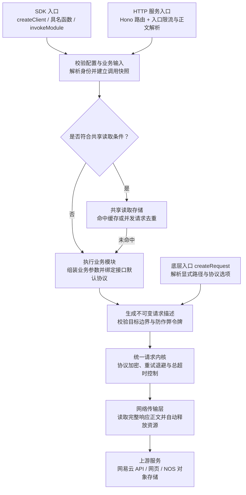
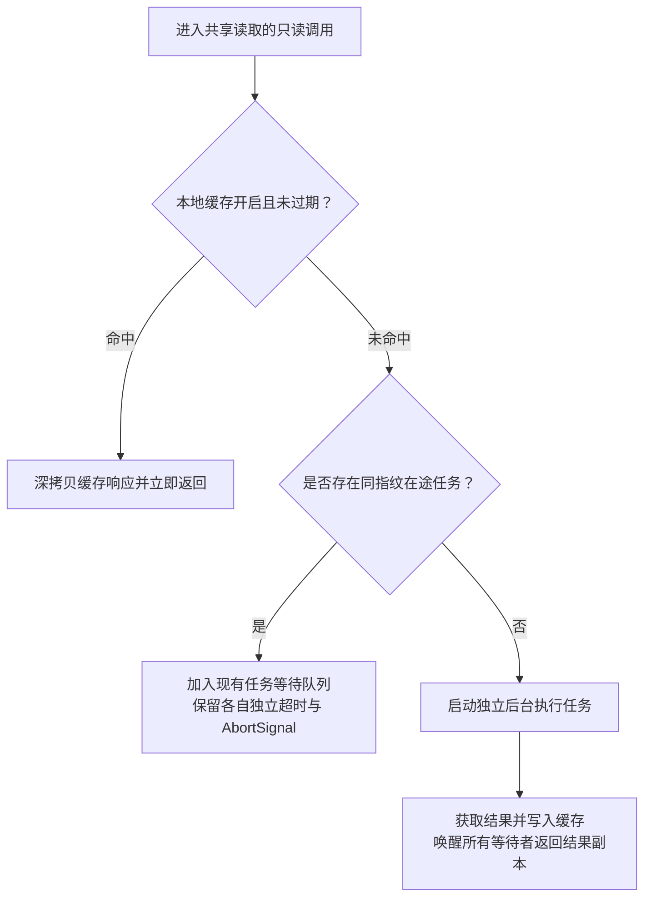
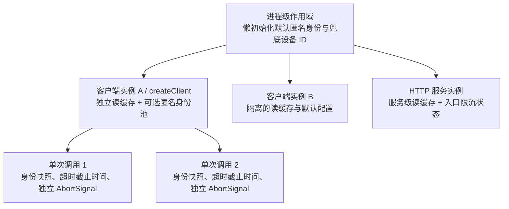
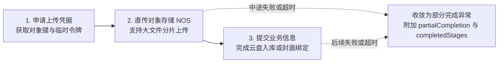

# 架构设计与技术演进

`hana-music-api` 基于 TypeScript 与 Effect 构建，通过不可变调用快照、统一请求内核与按需导出架构，系统性地解决了传统脚本式 API 库的并发安全、类型缺失与包体积膨胀问题。

## 相比传统实现的架构提升

下表从工程质量、并发模型与运行时边界五个核心维度，对比传统实现与 `hana-music-api` 的架构演进：

| 架构维度               | 传统 `NeteaseCloudMusicApi` 实现                                          | `hana-music-api` 设计提升                                                                          |
| ---------------------- | ------------------------------------------------------------------------- | -------------------------------------------------------------------------------------------------- |
| **类型与契约**         | 松散的运行时对象拼装，输入参数与返回字段均缺乏静态类型约束与校验          | 端到端 TypeScript 输入类型定义 + Standard Schema v1 已建模返回体校验，同时保留未确认字段的扩展能力 |
| **生命周期与并发安全** | 分散的回调与手工定时器，中途取消请求难以终止底层传输与回收句柄            | 基于 Effect 的结构化并发，支持全链路 `AbortSignal` 取消、统一总超时控制与传输资源自动释放          |
| **双入口统一内核**     | HTTP 路由与函数调用各自拼接请求逻辑，参数解析与异常表现易产生分歧         | SDK 与 Hono HTTP 服务共享同一套业务模块定义与单一请求内核，确保校验规则与上游行为完全一致          |
| **协议与身份收敛**     | 全局或半全局可变请求配置，并发请求间易出现 Cookie、设备 ID 或协议特征串扰 | 每次调用建立独立的不可变调用快照，协议、域名与客户端特征由接口默认协议驱动，消除全局状态污染       |
| **流量与包体积控制**   | 启动即全量加载所有模块，高频读取重复穿透上游且无法按需打包                | 提供 `./api/*` 按需子路径支持 Tree-shaking，内置基于多维指纹的并发请求去重与实例级读缓存           |

## 整体请求数据流

无论是通过 SDK 客户端、HTTP 服务路由还是底层 `createRequest` 发起请求，所有调用最终都会收敛到同一条受控请求内核：

- **前置入口校验**：SDK 与 HTTP 入口均在准备身份或查询缓存前先完成配置合法性与业务输入校验，非法输入不会触发游客注册或上游请求。
- **不可变调用快照**：每次调用都会固化本次使用的账号凭据、设备 ID 与出口 IP，即使全局运行时状态随后变更也不会污染正在执行的调用。
- **接口默认协议驱动**：业务模块只需传入业务参数与操作名，目标域名、加密协议、HTTP 方法与客户端特征均由接口默认协议自动绑定。
- **单一内核收敛**：普通模块与底层 `createRequest` 均通过同一请求内核执行 URL 目标校验、请求加密、重试退避与完整正文读取。

## 共享读取与并发去重

针对高频只读接口，实例内建共享读取存储同时管理 TTL 结果缓存与在途并发任务合并，避免重复穿透上游：

- **适用接口与退出条件**：当前仅 `search`、`lyric`、`song_detail` 与 `playlist_detail` 支持共享读取。当调用配置包含 `checkToken` 时，该次调用会自动跳过缓存与去重。
- **多维请求指纹**：共享键综合计算模块标识、已校验输入、账号身份指纹、传输实现与核心配置，确保不同账号或代理配置绝不混用结果。
- **单等待者取消**：多个调用方等待同一个在途任务时，单个调用方超时或触发 `AbortSignal` 仅扣减自身等待计数，上游请求会继续为其余等待者完成。
- **全部取消即中断**：只有当最后一个等待者也取消或超时退出时，共享存储才会立即中断底层上游请求并释放所有关联资源。

## 状态作用域分层

为避免不同用户、客户端或调用之间产生状态串扰，系统将运行时状态严格划分为三个作用域层级：

| 作用域层级              | 持有状态内容                                                                 | 隔离与影响范围                                                                  |
| ----------------------- | ---------------------------------------------------------------------------- | ------------------------------------------------------------------------------- |
| **进程级**              | 内存运行时状态（匿名游客令牌、兜底设备 ID 与默认出口 IP）                    | 按需懒初始化，同一进程内未显式提供身份的默认调用共享该基础状态                  |
| **客户端 / 服务实例级** | 共享读取任务表与可选 TTL 缓存、匿名身份池、HTTP 入口限流桶与信号量           | 不同 `createClient`、`createHanaMusicApi` 或 HTTP 服务实例的缓存与配额相互隔离  |
| **单次调用级**          | 冻结后的业务参数、身份快照、防作弊令牌使用计数、重试策略、超时时间与取消信号 | 仅作用于本次调用，局部传入的 `cookie` 或 `timeoutMs` 覆盖不影响同实例下其他调用 |

> **默认上下文缓存差异**：独立导出的具名函数、`invokeModule` 与未开启 `cache` 的客户端实例默认只执行并发请求去重，不保留已完成结果的 TTL 缓存。HTTP 服务与显式配置 `cache: { enabled: true }` 的客户端才会缓存已完成响应。

## 多阶段上传与失败收敛

文件上传（如云盘上传、播客声音上传与封面更新）涉及多次上游交互与对象存储直传。系统通过统一阶段预算与收敛机制确保异常状态可追踪：

- **分层超时预算**：普通接口默认总超时时间为 `8` 秒。上传模块单阶段网络请求上限为 `60` 秒，整个模块总超时时间上限为 `300` 秒。
- **部分完成追踪**：已经写入对象存储或远端接口的操作无法由本地取消回滚。若在完成部分阶段后失败，拒绝对象的 `body` 会携带 `partialCompletion: true` 与 `completedStages`（已完成请求阶段数）。
- **Promise 边界收敛**：所有内部校验、传输、解密与结构异常在抵达公开 Promise 边界时均统一收敛为 `{ status, body, cookie, failure }` 拒绝对象，成功响应则保持 `{ status, body, cookie }`。
- **结构化失败分类**：`failure.kind` 精确区分 `business`、`rateLimited`、`upstreamShape`、`timeout`、`cancelled`、`invalidRequest`、`transport` 与 `unknown` 八类原因，消费方式详见 [错误处理](/guide/error-handling)。
