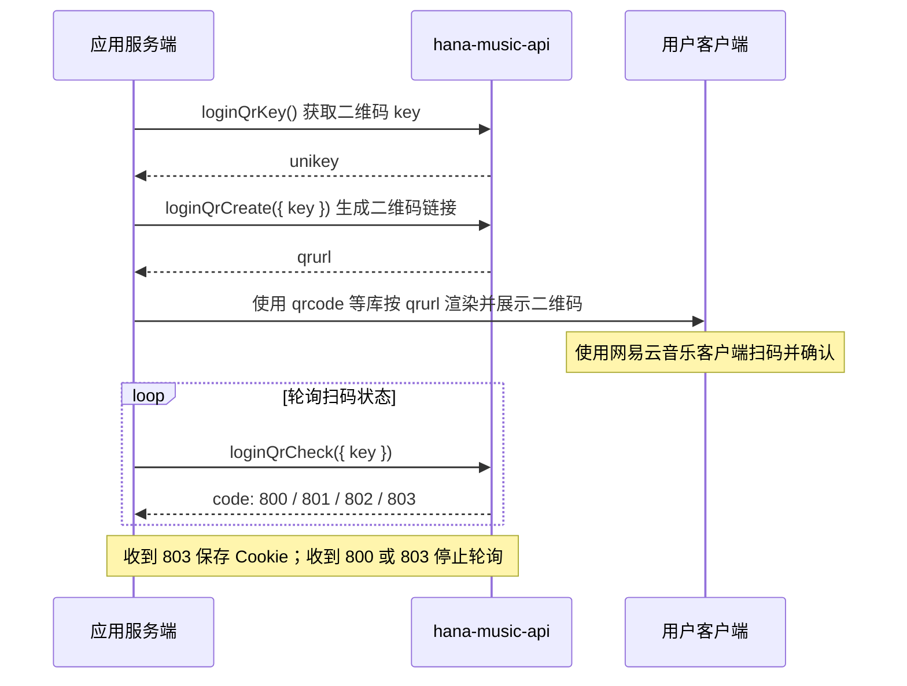

# 认证机制

搜索、歌词等公开接口可使用游客身份调用。获取账号信息、管理歌单、访问云盘或发送私信等操作需要有效的登录 Cookie。

## 登录方式对比

| 登录方式   | 对应接口                                               | 所需凭证与说明                            |
| ---------- | ------------------------------------------------------ | ----------------------------------------- |
| 手机号登录 | `/login/cellphone`                                     | `phone`，搭配密码、MD5 密码或短信验证码   |
| 邮箱登录   | `/login`                                               | 邮箱地址搭配密码或 MD5 密码               |
| 二维码登录 | `/login/qr/key`、`/login/qr/create`、`/login/qr/check` | 先申请 key，生成二维码并轮询扫码状态      |
| 游客模式   | `/register/anonimous`                                  | 获取匿名游客 Cookie，不可替代正式账号权限 |

实际能否完成登录取决于网易云服务端的风控验证与账号状态。建议持久化并复用已有 Cookie，避免高频重复登录。

## 二维码登录流程



轮询 `loginQrCheck` 时，SDK 返回的 `status` 均为 `200`，需根据 `body.code` 区分具体状态：

| 业务 `code` | 状态说明     | 应用处理动作                                             |
| ----------- | ------------ | -------------------------------------------------------- |
| `800`       | 二维码已过期 | 停止轮询，提示重新获取 key 生成新二维码                  |
| `801`       | 等待扫码     | 保持展示二维码并继续轮询                                 |
| `802`       | 待确认       | 可展示正文中的扫码用户昵称 `nickname` 与头像 `avatarUrl` |
| `803`       | 登录成功     | 从响应保存 Cookie 并停止轮询                             |

> 若前方部署了 CDN 或反向代理，应单独为登录与轮询路由配置禁用缓存。

- **行为验证拒绝**：扫码触发行为验证（如 `code: 8821`）时，`loginQrCheck` 会直接 reject Promise。
- **不走读缓存**：登录与二维码轮询默认跳过 SDK 本地读缓存，无需额外拼接时间戳参数。
- **调试示例**：从源码运行内置 HTTP 服务时，可访问 `/demo/qr-login` 体验完整扫码流程。

## 保存与复用 Cookie

SDK 响应对象在顶层返回 `cookie` 字符串数组，部分登录接口也会在 `body.cookie` 中提供分号拼接的字符串。客户端实例**不会**自动把登录响应写入默认配置，须由调用方自行保存并在后续请求中传入。

```ts
import { createHanaMusicApi, loginCellphone } from 'hana-music-api';

const loginResult = await loginCellphone({
  phone: 'your-phone-number',
  captcha: 'your-captcha',
});

const cookie = loginResult.cookie.join('; ');
const hana = createHanaMusicApi({ cookie });
const account = await hana.userAccount({});

console.log(account.body);
```

单模块具名函数可直接通过第二个参数传入认证信息：

```ts
import { userAccount } from 'hana-music-api';

const result = await userAccount({}, { cookie: 'MUSIC_U=your-cookie' });
console.log(result.body);
```

- **风控处理**：短信登录遇到 `code: 10004` 风控拦截时，需引导用户跳转至响应中的 `redirectUrl` 完成验证，详情见 [手机号登录](/api/user/login-cellphone)。
- **会话续期**：保存 Cookie 后无需留存账号密码，可使用 [刷新登录](/api/user/login-refresh) 延长会话有效期。

## HTTP 传递 Cookie

自托管 HTTP 服务支持通过标准请求头 `Cookie` 传递凭证，也支持在 URL query 或请求 body 的 `cookie` 字段中传递。当三处同时出现时，按请求头、query、body 的顺序整体覆盖，而不是合并键值对。

- **写入响应头**：服务端默认将上游下发的 Cookie 通过 `Set-Cookie` 写回响应头，HTTPS 请求下自动附加 `SameSite=None; Secure`。
- **跨域请求**：浏览器跨域调用需携带 `credentials: 'include'` 并满足 HTTPS 安全上下文。
- **禁用写回**：传入 `noCookie=true` 或 `noCookie=1` 仅阻止服务端在响应头写入 `Set-Cookie`，不会清除本次请求已携带的登录身份。

完整的 HTTP 传参顺序与头处理规则见 [HTTP 调用约定](/guide/http-conventions)。

## 游客模式行为

当接口需要协议会话、且本次调用未提供 `MUSIC_U`、`MUSIC_A` 或 `state.anonymousToken` 时，SDK 会在内存中自动注册并复用游客身份（仅发起一次请求，多个并发调用自动合并等待）。

- **权限限制**：游客身份无法访问需账号登录的接口，若遇到需要登录的错误提示，应检查 `cookie` 是否失效或被单次调用配置覆盖。
- **身份优先级**：显式账号 Cookie（`MUSIC_U`）优先级最高，其次为显式游客凭证（`MUSIC_A` 或 `state.anonymousToken`），再次为身份池与进程内缓存的匿名身份。

设备 ID 生成与身份选择细节见 [运行时身份与状态](/guide/runtime-identity)。
