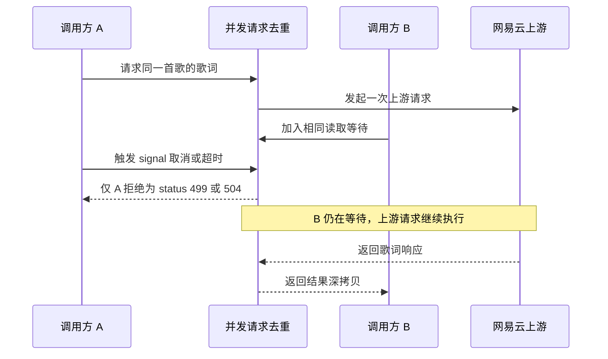

# 缓存、并发去重与身份池

同一份数据可能在同一时刻被多处并发读取，或在短时间内被重复查询。SDK 提供并发请求去重与可选响应缓存来减少上游请求，并提供 `identityPool` 为未登录读取轮换多套游客身份。

## 缓存与并发请求去重

并发请求去重与响应缓存是两种独立机制，目前均适用于 [search](/api/search/search)（含 `type: 2000` 语音搜索）、[lyric](/api/music/lyric)、[songDetail](/api/music/song-detail) 和 [playlistDetail](/api/playlist/playlist-detail) 四个只读模块。

| 机制         | 触发时机                                   | SDK 默认状态                                               |
| ------------ | ------------------------------------------ | ---------------------------------------------------------- |
| 并发请求去重 | 相同读取仍在执行时，后续调用共享本次执行   | 默认对上述四个只读接口启用                                 |
| 响应缓存     | 读取已经成功后，后续调用直接复用未过期结果 | 默认关闭，需在 `createHanaMusicApi` 或 `createClient` 开启 |

```ts
import { createHanaMusicApi } from 'hana-music-api';

const hana = createHanaMusicApi({
  cookie: 'MUSIC_U=your-cookie',
  cache: { ttlMs: 120_000 },
});

const first = await hana.search({ keywords: '海阔天空' });
const second = await hana.search({ keywords: '海阔天空' });

console.log(first.body, second.body);
```

- **缓存写入条件**：仅当 `status === 200` 且正文 `code` 未定义或等于 `200` 时才写入缓存。命中缓存或共享去重时返回 `structuredClone` 深拷贝，修改返回对象不会污染其他调用方取得的数据。
- **显式关闭缓存**：传入 `cache: { enabled: false }` 后不再保存已完成的响应，但执行中的并发请求去重仍然生效。
- **排除缓存的场景**：写操作、登录、轮询、批量、上传、底层 `createRequest` 以及上述四项之外的模块均不启用共享读取或缓存。单次调用传入 `checkToken` 时也会跳过缓存与并发去重。
- **`timestamp` 无效说明**：部分调用习惯通过变化的 `timestamp` 字段刷新结果，但标准模块在校验输入时会移除未声明字段，不会使缓存键发生变化。需要始终获取最新数据时，请使用未开启缓存或设置 `cache: { enabled: false }` 的客户端实例。

## 缓存作用域与缓存键

不同调用入口的缓存与去重作用域相互隔离：

- **client 实例**：通过 `createHanaMusicApi` 或 `createClient` 创建的每个实例持有独立的读取状态，同一实例内的方法共用去重队列与响应缓存，不同实例间互不共享。
- **具名函数与 `invokeModule`**：所有直接导出的具名函数与 `invokeModule` 共用进程级默认上下文，支持上述四个只读接口的并发请求去重，默认不保留已完成响应的缓存。
- **HTTP 服务实例**：每个运行中的 HTTP 服务实例默认开启 120 秒响应缓存（可在启动选项中关闭或调整时间），不与外部 SDK client 共用状态。

缓存键由以下信息共同计算，任意一项不同即视为独立请求：

- **接口标识与请求动作**：模块标识符以及该模块绑定的接口目标配置。
- **解码后的业务参数**：经过输入校验并归一化后的参数对象。
- **生效的执行配置**：排除 `onRequestEvent` 与 `timeoutMs` 后的请求配置（含解析后的 `cookie`、`ip`/`realIP`、`proxy`、`retry`、`connectionStrategy`、`state` 等）。
- **有效身份指纹**：当前生效的会话令牌与设备 ID 组合摘要。账号或设备 ID 不同时不会命中彼此的缓存。
- **传输实现引用**：模块执行函数与 `fetcher` 函数的实例标识。

> [!NOTE]
> 每个缓存实例内部最多保留 `10000` 条未过期记录，超出容量时按写入顺序淘汰最早的条目。

## 并发请求去重的取消行为

当多个调用同时请求同一份数据时，SDK 只向上游发起一次网络请求。每位调用方的取消信号与 `timeoutMs` 超时时间均独立计算，互不干扰。



只有在最后一个等待者也取消或超时后，内核才会真正中断正在进行的上游请求。关于内部执行范围与超时控制，请参见 [超时、取消与重试](/guide/resilience) 与 [架构设计与技术演进](/guide/architecture)。

## 游客身份池（identityPool）

对于高并发只读服务或缺少登录账号的场景，可以在创建客户端时配置 `identityPool`，为未携带显式会话的 API 调用自动轮换多套独立游客身份。

```ts
import { createHanaMusicApi } from 'hana-music-api';

const hana = createHanaMusicApi({ identityPool: { size: 2 } });
const result = await hana.search({ keywords: '海阔天空' });

console.log(result.body);
```

- **延迟与并发安全初始化**：调用 `createHanaMusicApi` 时不会立即注册游客身份。首次需要协议会话的 API 调用才会按 `size` 依次注册游客凭据（每套包含独立的 `anonymousToken`、`deviceId` 与 `cnIp`），并在之后按次轮换使用。并发发起的首次调用会共用同一轮初始化，若部分注册中途失败，已成功注册的身份会保留，后续调用继续补齐剩余数量。
- **池大小限制**：`identityPool.size` 必须为大于或等于 `1` 的正数，小数会被向下取整。
- **显式身份与设备 ID 绕过规则**：若本次调用已提供 `MUSIC_U`、`MUSIC_A` 或 `state.anonymousToken`，直接使用显式身份，不经过身份池。若调用方已提供有效的 `state.deviceId` 或 `cookie.deviceId`，同样会绕过身份池并保留调用方设备 ID（缺失凭据时回退到常规匿名初始化）。
- **无会话接口不初始化**：纯本地计算或仅访问外部直链的模块不会触发身份池注册。
- **使用边界**：身份池初始化耗时计入首次调用的 `timeoutMs`。轮换身份会体现在缓存键区分与请求头 `cnIp` 上，但不会改变实际网络出口 IP，也不能用来规避网易云的上游限频。
