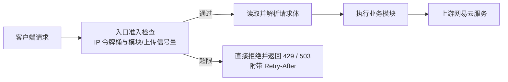

# 部署 HTTP 服务

HTTP 服务基于 Bun 运行时从仓库源码启动。公开 npm 包根入口仅导出 SDK，不包含 `startServer` 或服务端运行时。

## 从源码启动

在已安装 Bun 的环境中克隆仓库并启动服务：

```bash
git clone https://github.com/campanula-music/hana-music-api.git
cd hana-music-api
bun install --frozen-lockfile
bun run docs:build
bun start
```

- **默认监听地址**：服务默认监听 `http://0.0.0.0:3021`，本地可通过 `http://127.0.0.1:3021` 访问。
- **基础服务端点**：`/` 展示服务欢迎页，`/health` 返回服务名称、健康状态与版本号 JSON。
- **交互调试页面**：`/demo` 提供扫码登录、搜索、听歌识曲与歌单封面上传等内置示例页面。
- **静态文档入口**：`/docs` 提供构建后的 VitePress 文档，跳过 `bun run docs:build` 仍可运行 API 接口，但访问 `/docs` 会返回 `503` 构建提示页。
- **文档更新与预览**：修改文档后需重新运行 `bun run docs:build` 刷新 `/docs` 静态产物，单独开发预览可运行 `bun run docs:dev`。

## CLI 环境变量

CLI 入口通过以下环境变量配置监听地址与匿名令牌路径：

| 环境变量               | 默认值                             | 说明                       |
| ---------------------- | ---------------------------------- | -------------------------- |
| `HOST`                 | `0.0.0.0`                          | HTTP 服务监听主机地址      |
| `PORT`                 | `3021`                             | HTTP 服务监听端口          |
| `ANONYMOUS_TOKEN_FILE` | 系统临时目录下的 `anonymous_token` | 匿名游客令牌持久化文件路径 |

- **启动前令牌准备**：CLI 启动时会优先读取 `ANONYMOUS_TOKEN_FILE` 中的已有令牌，缺失时自动注册匿名游客令牌并写入该路径。
- **持久化存储建议**：需要跨服务重启或容器重建保留同一匿名身份时，请将 `ANONYMOUS_TOKEN_FILE` 指向持久可写目录。
- **生产模式启动**：生产环境可运行 `bun run start:prod`（自动注入 `NODE_ENV=production`），监听地址与端口仍由 `HOST` 和 `PORT` 控制。

## 使用 PM2 部署

仓库根目录已提供 `ecosystem.config.cjs` 进程配置文件：

```bash
npm install -g pm2
pm2 start ecosystem.config.cjs
```

- **Bun 解释器**：配置通过 `interpreter: 'bun'` 运行 `src/app/cli.ts`，请确保 PM2 执行环境的 `PATH` 中包含 `bun`。
- **单进程托管**：默认以单实例 `fork` 模式启动（`instances: 1`），开启自动重启且内存上限设为 `512M`。
- **日志与令牌路径**：输出日志写入 `./logs/pm2-out.log` 与 `./logs/pm2-error.log`，匿名令牌默认保存至 `./data/runtime/anonymous_token`。
- **默认环境变量**：配置默认注入 `NODE_ENV=production`、`HOST=0.0.0.0` 与 `PORT=3021`，可根据部署需求直接调整 `ecosystem.config.cjs`。

## 自定义服务启动选项

缓存开关、请求体限制、并发限流与可信代理属于源码级服务选项，不能通过任意环境变量生效。如需调整这些选项，可在仓库根目录新建自定义启动脚本（如 `server.ts`）：

```ts
import { ensureAnonymousToken, startServer } from './src/app/cli.ts';

await ensureAnonymousToken();
await startServer({
  hostname: '127.0.0.1',
  port: 3021,
  cacheEnabled: false,
  maxBodyBytes: 25 * 1024 * 1024,
  bodyTimeoutMs: 10_000,
});
```

执行 `bun server.ts` 即可按自定义配置启动服务。该相对路径导入仅适用于仓库源码部署，不适用于通过 npm 安装的 SDK 包。

| 选项                        | 默认值                         | 说明                                               |
| --------------------------- | ------------------------------ | -------------------------------------------------- |
| `hostname`                  | `'0.0.0.0'`（优先读取 `HOST`） | 服务监听主机地址                                   |
| `port`                      | `3021`（优先读取 `PORT`）      | 服务监听端口号                                     |
| `silent`                    | `false`                        | 设为 `true` 时不打印启动监听地址日志               |
| `serviceName`               | `'hana-music-api'`             | `/` 与 `/health` 返回的服务名称                    |
| `serviceVersion`            | 当前包版本号                   | `/health` 返回的服务版本字符串                     |
| `cacheEnabled`              | `true`                         | 是否缓存可共享只读接口的成功响应                   |
| `cacheTtlMs`                | `120000`                       | 读缓存有效时间，单位为毫秒                         |
| `maxBodyBytes`              | `10485760`（10 MiB）           | 客户端请求体与上传内容的最大字节数                 |
| `bodyTimeoutMs`             | `5000`                         | 读取客户端请求体的超时时间，单位为毫秒             |
| `corsAllowOrigin`           | 回显请求 `Origin` 或 `'*'`     | 指定允许跨域请求的 `Access-Control-Allow-Origin`   |
| `docsDistDirectory`         | `website/.vitepress/dist`      | `/docs` 静态文档产物目录路径                       |
| `traffic.requestsPerSecond` | `2`                            | 单个客户端 IP 每秒恢复的令牌桶额度                 |
| `traffic.burst`             | `10`                           | 单个客户端 IP 允许的突发请求额度                   |
| `traffic.maxInFlight`       | `32`                           | 服务端允许同时执行的模块请求总数                   |
| `traffic.maxUploads`        | `2`                            | 服务端允许同时执行的上传模块数量                   |
| `traffic.trustedProxyIps`   | 未配置（不信任代理头）         | 允许解析 `X-Forwarded-For` 的可信代理 IP 列表      |
| `debugApiRequests`          | `false`                        | 是否开启本地调试请求接口 `/demo/api-debug/request` |

> **关于 `multipart/form-data` 请求体限制**：表单总字节数在 `maxBodyBytes` 之外预留 `64 KiB` 的表单边界与头部余量，但所有文件字段之和与文本字段之和各自仍受 `maxBodyBytes` 限制。体积超限会返回 `413`，读取客户端请求体超时会返回 `408`（区别于上游调用超时返回的 `504`）。

## 入口限流与并发保护

HTTP 服务在入口中间件统一执行 IP 频率限制与并发容量保护：



- **前置拦截机制**：入口检查在读取请求体之前执行，被拒绝的请求不会消耗后续解析或上游调用资源。
- **IP 令牌桶限流**：按来访 IP 维护令牌桶（内存中最多追踪 `10000` 个活跃 IP），触发限流时返回 `429` 与 `Retry-After`。
- **并发信号量保护**：普通模块与上传模块分别受 `maxInFlight` 与 `maxUploads` 信号量保护，满额时返回 `503` 与 `Retry-After`。
- **免检路由范围**：静态资源、`/docs` 文档页面、`/` 欢迎页与 `/health` 健康检查不消耗限流与并发额度。
- **无二次出口限流**：通过入口准入的请求会直接发送至上游，服务端不设二次出口限流。进程内直接调用 SDK 不经过本层限制，请求频率控制见 [重试、超时与连接策略](/guide/resilience)。

## 反向代理配置

将服务部署在 Nginx、Caddy 等反向代理之后时，请正确配置代理转发规则：

- **可信代理白名单**：服务默认以真实 TCP 连接 IP 区分客户端。仅当连接 IP 位于 `traffic.trustedProxyIps` 时，才采用 `X-Forwarded-For` 中第一个合法 IP。
- **本机代理示例**：代理与本服务运行在同一主机并通过 `127.0.0.1` 转发时，须设置 `traffic: { trustedProxyIps: ['127.0.0.1'] }`。
- **覆盖转发头**：反向代理必须使用客户端真实 IP 覆盖 `X-Forwarded-For`，不得直接追加客户端自带的请求头内容。
- **透传 HTTPS 协议头**：由反向代理终止 TLS 时，须向后端透传 `X-Forwarded-Proto: https`，以确保写回 Cookie 时正确附加 `SameSite=None; Secure`。
- **多实例统一限流**：多进程或容器多副本部署时，各进程内存中的限流配额互不共享，应在反向代理层配置全局限流。

## 本地调试入口

`/demo/api-debug/request` 用于配合 `/demo/api-debug` 页面执行受控接口调试：

- **默认关闭保护**：生产与常规启动下该接口默认关闭，访问将直接返回 `404`。
- **回环地址限制**：仅当通过源码 `startServer` 启动且 `hostname` 为回环地址（`127.0.0.1`、`localhost` 或 `::1`）时，才允许开启 `debugApiRequests: true`。
- **受控参数范围**：即使启用后，该入口也仅接受合法的 `/api/` 路径与标准加密模式（`api`、`eapi`、`weapi`、`linuxapi` 或空字符串）。

日常接口传参、Cookie 规则与缓存策略详见 [HTTP 调用约定](/guide/http-conventions)。
