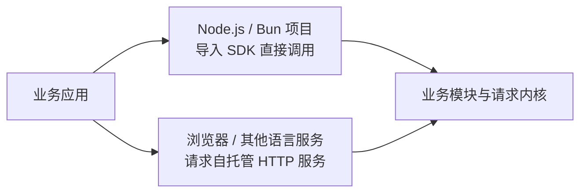

# 简介

`hana-music-api` 是使用 TypeScript 实现的第三方网易云音乐 API 库，提供 352 个覆盖常见音乐业务的接口。它沿用 `NeteaseCloudMusicApi` 的接口命名习惯，既可以作为 SDK 引入应用代码，也可以直接启动为独立 HTTP 服务。

## 核心特性

- **双模式复用**：SDK 与 HTTP 服务共用同一套业务模块与请求内核，接口行为保持一致。
- **Promise API 封装**：内部负责协议加密、超时控制、请求取消与并发请求去重，外部仅需 `async/await` 调用。
- **按需导入友好**：支持按单接口子路径与 `createClient` 组合打包，只包含实际使用的模块。
- **完整类型与运行时校验**：所有接口提供明确的入参类型，315 个高频接口具备已建模返回体类型与 Standard Schema 校验。

## 接入方式对比

| 对比维度 | SDK 编程式调用                 | 自托管 HTTP 服务               |
| -------- | ------------------------------ | ------------------------------ |
| 运行环境 | Node.js >= 24（仅 ESM）或 Bun  | 从源码仓库通过 Bun 启动        |
| 适用场景 | Node.js / Bun 后端、脚本、BFF  | 浏览器端调用或非 JS 语言接入   |
| 参数形式 | 原生数组、对象、数字与布尔值   | URL query、JSON 或表单 body    |
| 返回形式 | `{ status, body, cookie }`     | HTTP 状态码、JSON 正文与响应头 |
| 隔离控制 | 可按次传入代理、超时、取消信号 | 服务启动时统一配置并发与限流   |

## 类型系统与返回体边界

自 5.x 版本起，`LegacyModuleInput` 已彻底移除。除 `batch` 接收子路由键映射外，全部 352 个接口均声明了具体的业务 `ModuleInput` 类型。

- **入参校验**：SDK 具名函数、`createClient` 方法及 HTTP 入口均按模块声明校验入参，未声明字段会在发送前以 `status: 400` 拒绝。
- **已建模返回体**：315 个接口导出 `<Name>Body` 类型与运行时校验器，返回时校验必填字段并推断完整类型，详见 [返回值与错误处理](/guide/error-handling)。
- **未建模接口**：其余 37 个接口返回类型为 `UnknownJson`，原样返回服务端响应 JSON，读取嵌套字段前应自行检查类型。

## 第三方实现边界

> `hana-music-api` 是第三方网易云音乐 API 实现，接口可用性与返回字段仍受网易云服务端策略影响。配置请求头来源 IP、游客身份或重试策略均不保证绕过上游风控与频控限制。

## 下一步

- 阅读 [快速开始](/guide/getting-started) 完成 SDK 安装或 HTTP 服务启动。
- 查看 [SDK 调用方式](/guide/sdk-usage) 了解四种调用形态与参数规范。
- 浏览 [架构设计与技术演进](/guide/architecture) 了解请求生命周期与各层职责。
