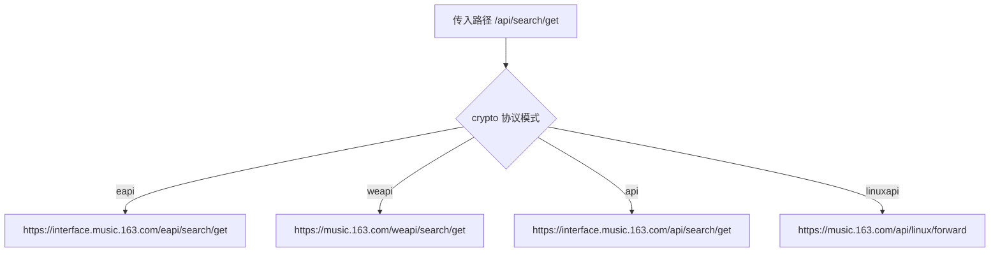
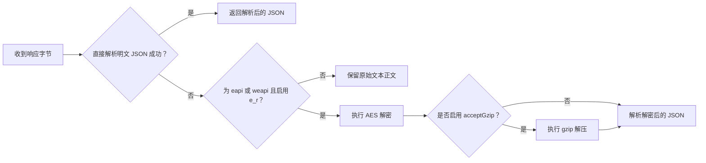

# 底层请求与加密模式

当需要调用尚未建模的网易云接口，或需要手工覆盖加密模式、目标域名、响应解密、gzip 压缩与自定义请求头时，可使用底层入口 `createRequest`。日常业务开发仍应优先使用已封装的标准模块函数。

## 适用场景与边界

`createRequest` 复用核心请求层执行加密编码、超时控制与响应解码，但与标准模块存在以下重要边界差异：

- **需手写上游参数**：不会执行模块级的业务参数校验或字段转换（例如搜索接口需直接传上游参数 `s`，而非标准模块的 `keywords`）。
- **无缓存与重试**：底层请求没有只读操作声明，不启用响应缓存、并发请求去重与自动重试（即使传入 `retry` 配置也不会重试）。
- **无自动游客初始化**：不会触发 SDK 隐式游客注册或 `identityPool` 轮换，仅直接使用本次提供的凭据或当前进程内存状态。
- **目标域安全校验**：并不是任意 URL 的通用代理。携带 `MUSIC_U` 或 `MUSIC_A` 凭据时，仅允许发往受信任的 HTTPS 网易云 API 域名。
- **不接收 `checkToken`**：`checkToken` 为标准模块专用选项，传入 `createRequest` 会在执行前被拒绝（`status: 400`）。

## createRequest 基本用法

```ts
import { createRequest } from 'hana-music-api';

const result = await createRequest(
  '/api/search/get',
  { s: '海阔天空', type: 1, limit: 5, offset: 0 },
  { crypto: 'eapi', cookie: 'MUSIC_A=your-anonymous-token' },
);

console.log(result.status, result.body, result.cookie);
```

| 参数      | 类型                           | 说明                                                       |
| --------- | ------------------------------ | ---------------------------------------------------------- |
| `uri`     | `string`                       | 必须以 `/api/` 开头的上游逻辑路径                          |
| `data`    | `Record<string, unknown>`      | 加密前发送给上游的原始业务数据对象                         |
| `options` | `CreateRequestOptions`（可选） | 包含通用配置与底层专属选项，详见 [配置参考](/guide/config) |

调用失败时同样抛出带有 `failure` 属性的响应对象，返回值处理与异常守卫见 [错误处理](/guide/error-handling)。

> [!IMPORTANT]
> `uri` 必须传入以 `/api/` 开头的原始逻辑路径，不能传入已转换过的 `/eapi/...` 或 `/weapi/...` 路径，否则会在发送前直接拒绝。



## 加密模式

网易云上游按接口通道采用四种请求加密协议。标准模块已通过各自的接口默认协议固定对应方式，直接调用 `createRequest` 时未指定 `crypto` 或传入空字符串均默认采用 `'eapi'`。

| 模式       | 默认上游地址                      | 请求体编码与加密方式                                              | 默认匹配身份     |
| ---------- | --------------------------------- | ----------------------------------------------------------------- | ---------------- |
| `weapi`    | `music.163.com/weapi/*`           | 双层 AES-128-CBC 与 RSA 加密，输出 `params` 与 `encSecKey`        | Web 浏览器 UA    |
| `eapi`     | `interface.music.163.com/eapi/*`  | 注入请求头元数据与 MD5 校验后使用 AES-128-ECB 加密，输出 `params` | iPhone 客户端 UA |
| `api`      | `interface.music.163.com/api/*`   | `application/x-www-form-urlencoded` 明文表单数据，不加密请求体    | iPhone 客户端 UA |
| `linuxapi` | `music.163.com/api/linux/forward` | 打包原路径与参数后使用 AES-128-ECB 加密，输出 `eparams`           | Linux 桌面端 UA  |

- **平台身份自动补全**：在 `createRequest` 中，若 Cookie 包含已知 `os`（如 `pc`、`android`、`linux`、`osx`、`web`、`iphone`、`iPhone OS`），请求层会按该平台补齐未指定的默认字段与 `User-Agent`。未知平台名不会自动补充默认 UA。
- **防重放字段生成**：无论采用哪种模式，请求层都会自动生成或补齐所需的请求防重放字段与基础会话 Cookie，详见 [运行时状态与身份](/guide/runtime-identity)。

## 底层专属选项（CreateRequestOptions）

除通用网络、代理、重试、取消与状态字段外，`CreateRequestOptions` 额外开放以下底层覆盖选项（不可用于标准模块调用）：

| 字段         | 类型                                             | 默认值                           | 说明                                                        |
| ------------ | ------------------------------------------------ | -------------------------------- | ----------------------------------------------------------- |
| `crypto`     | `'' \| 'api' \| 'eapi' \| 'weapi' \| 'linuxapi'` | `'eapi'`                         | 指定协议加密模式，空字符串等同于 `'eapi'`                   |
| `domain`     | `string`                                         | 随 `crypto` 匹配内置网易云域名   | 覆盖请求目标域名，携带身份时受允许域名白名单检查            |
| `e_r`        | `BooleanLike`                                    | `false`（可回退读取 `data.e_r`） | 请求上游返回加密响应并在 `eapi` / `weapi` 模式下解密        |
| `acceptGzip` | `boolean`                                        | `false`                          | 在 `eapi` 模式下附加 `x-aeapi: true` 头并启用 gzip 解压     |
| `ua`         | `string`                                         | 按协议或 `cookie.os` 自动生成    | 显式覆盖 `User-Agent`，优先级高于 `headers['User-Agent']`   |
| `headers`    | `Record<string, string>`                         | `{}`                             | 附加自定义请求头，`Cookie` 可作缺失 `options.cookie` 的后备 |

> [!NOTE]
> 上述 6 个选项以及顶层 `headers` 仅允许用于 `createRequest`。在标准模块中传入这些选项会在校验阶段被拒绝，参见 [配置参考](/guide/config)。

## 加密响应与 gzip 处理

部分 `eapi` 与 `weapi` 接口支持在请求参数中开启 `e_r` 以返回十六进制加密响应。`eapi` 还可配合 `acceptGzip`（或显式请求头 `x-aeapi: true`）要求上游返回经过 gzip 压缩的加密字节。



- **解析顺序**：内核总是先尝试按普通 JSON 解析响应正文。仅在 JSON 解析失败、协议为 `eapi` 或 `weapi` 且启用 `e_r` 时，才会执行解密流程。
- **与上游契合**：`e_r` 与 `acceptGzip` 必须与目标接口的实际支持情况匹配，开启选项本身不会使不支持加密或压缩的接口改变响应格式。

## 使用 createOption 提取旧式参数

如果需要将旧版扁平混合参数对象桥接至 `createRequest`，可使用导出的 `createOption` 工具函数从中抽取并转换执行配置：

```ts
import { createOption, createRequest } from 'hana-music-api';

const legacyInput = {
  keywords: '海阔天空',
  cookie: 'MUSIC_A=your-anonymous-token',
  timeoutMs: '5000',
};

const options = createOption(legacyInput, 'eapi');
const result = await createRequest(
  '/api/search/get',
  { s: legacyInput.keywords, type: 1, limit: 5, offset: 0 },
  options,
);
console.log(result.body);
```

- **仅限底层使用**：`createOption` 生成 `CreateRequestOptions` 对象，不能传给标准模块或 `createHanaMusicApi` / `createClient`。
- **协议优先级**：第二个参数为默认 `crypto` 模式。若第一个参数对象中已包含合法的 `crypto` 值，则以对象中的值为准。
- **仅做配置整理**：`createOption` 同步提取并格式化已知执行字段（例如将字符串 `'5000'` 转换为数字 `timeoutMs`），不会校验具体业务参数，也不会发起网络请求。
- **新代码建议**：常规模块调用请直接将业务参数与 `ModuleCallConfig` 分开传入，迁移细节见 [从 6.x 升级到 7.x](/guide/migrating-to-v7) 与 [SDK 用法](/guide/sdk-usage)。
