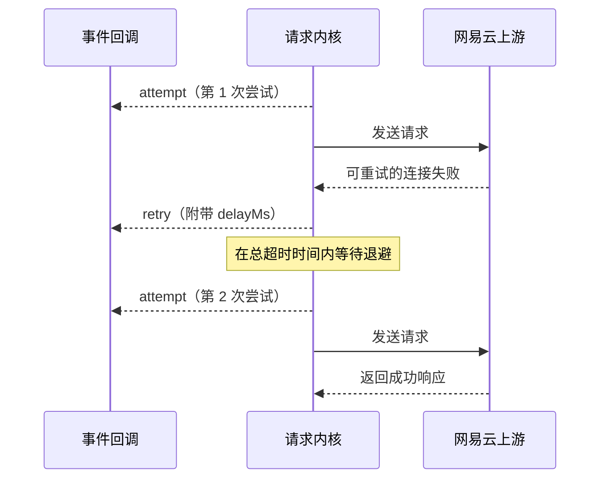

# 调试与可观测性

排查请求是否触发了自动重试或定位上游失败原因时，可通过 `onRequestEvent` 订阅请求尝试事件。需要度量包含身份准备与正文读取在内的完整延迟时，应在调用外层计时。

## 请求事件回调

`onRequestEvent` 可配置在 `createHanaMusicApi`、`createClient`、单次模块调用配置或 `createRequest` 中，用于接收请求内核派发的 `RequestDebugEvent` 事件。

```ts
import { createHanaMusicApi } from 'hana-music-api';

const hana = createHanaMusicApi({
  onRequestEvent(event) {
    console.log({
      type: event.type,
      attempt: event.attempt,
      status: event.status,
      durationMs: event.durationMs,
      delayMs: event.delayMs,
      url: event.url,
    });
  },
});

await hana.search({ keywords: '海阔天空' });
```

> [!TIP]
> 事件回调仅用于日志或指标观测，内部应保持轻量且避免抛出异常。事件中的 `url` 已自动剥离 query 参数且不包含 Cookie、请求正文或未脱敏的 `checkToken`。

| 事件类型  | 触发时机                                          |
| --------- | ------------------------------------------------- |
| `attempt` | 请求内核即将开始一次发送尝试（含首次尝试与重试）  |
| `retry`   | 当前尝试失败且命中重试规则，等待 `delayMs` 后重发 |
| `failure` | 当前尝试遇到无法继续重试的失败                    |



## 事件字段说明

事件对象的公开类型为 `RequestDebugEvent`，可从主入口或 `/core`、`/utils` 导出类型中导入。

| 字段                 | 类型                                | 说明                                                                 |
| -------------------- | ----------------------------------- | -------------------------------------------------------------------- |
| `type`               | `'attempt' \| 'retry' \| 'failure'` | 当前事件类型                                                         |
| `attempt`            | `number`                            | 当前尝试序号，从 `1` 开始计数                                        |
| `maxAttempts`        | `number`                            | 当前策略记录的尝试次数上限（实际失败前未必达到此上限）               |
| `connectionStrategy` | `RequestConnectionStrategy`         | 本次尝试使用的连接策略（重试阶段自动切换为 `'close'`）               |
| `crypto`             | `RequestCrypto`                     | API 协议加密模式，普通直链或上传资源请求为空字符串 `''`              |
| `url`                | `string`                            | 已剥离 query 字符串的请求目标地址                                    |
| `status`             | `number \| undefined`               | 失败状态码（在 `retry` 或 `failure` 事件中可用时提供）               |
| `error`              | `string \| undefined`               | 失败摘要信息（若含 `checkToken` 值会自动脱敏为 `[redacted]`）        |
| `durationMs`         | `number \| undefined`               | 单次失败尝试的耗时（毫秒），`createRequest` 边界补充事件含外层总耗时 |
| `delayMs`            | `number \| undefined`               | 下一次重试前等待的毫秒数（仅 `retry` 事件提供）                      |

使用事件回调时需注意以下观测边界：

- **尝试次数不等同发包次数**：`attempt` 在发送准备阶段触发，不能直接当作实际抵达网络的请求计数。一次最终成功的调用也可能包含多次 `attempt` 与 `retry`。
- **跳过网络层时无事件**：输入参数拒绝、响应缓存命中、纯本地模块执行或调用开始前即被 `signal` 取消时，均不会触发网络请求事件。
- **并发请求去重不重复派发**：多个调用方合并共享同一次读取时，事件仅在该次上游请求周期内触发一次，不会为每个等待者重复回调。
- **失败判定以 Promise 为准**：不要依赖 `failure` 事件统计全部调用错误，也不要将未触发 `failure` 视为调用成功。`createRequest` 在外层超时或取消时还会补充一条 `failure` 事件，业务侧应始终依据 Promise 结果与 [错误处理](/guide/error-handling) 判定成败。

## 统计完整调用耗时

在模块调用外层包裹 `performance.now()`，可将身份准备、缓存排队、请求重试与响应解码全部纳入同一次计时：

```ts
import { search } from 'hana-music-api';

const startedAt = performance.now();
try {
  const result = await search({ keywords: '海阔天空' });
  console.log(result.status, result.body);
} catch (error: unknown) {
  console.error(error);
} finally {
  console.log({ elapsedMs: performance.now() - startedAt });
}
```

## 与自定义 fetcher 的分工

- **`onRequestEvent`**：聚焦于请求内核内部的尝试次数、退避间隔、连接策略切换以及失败状态追踪，无需介入网络流处理。
- **自定义 `fetcher`**：聚焦于传输层实现本身，可观测最终组装好的请求头、底层 socket 异常或控制响应头到达时机，详见 [HTTP 代理与自定义 fetcher](/guide/proxy-and-fetcher)。
