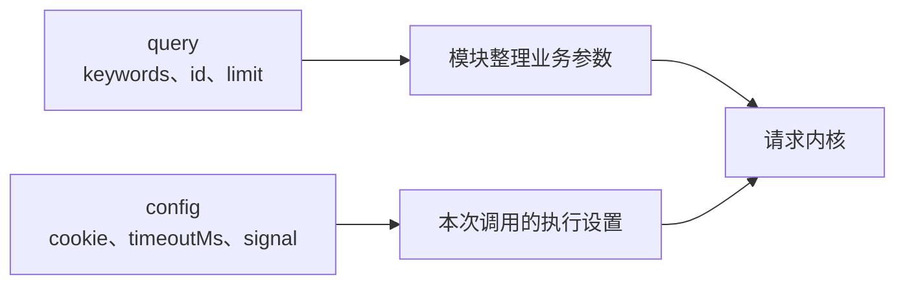

# 编程式调用

升级到 4.x 时，请先按[迁移说明](/guide/migrating-to-v4)移除旧配置键，再核对设备与 token 的保存和传递方式。

SDK 的常用入口有三个：创建 client、导入具名函数、按模块名调用。它们都返回 Promise，业务参数和执行配置分开传。

## 连续调用多个接口

`createHanaMusicApi` 将一组默认配置绑定到 client。适合共享 Cookie、缓存或自定义 `fetcher` 的场景。

```ts
import { createHanaMusicApi } from 'hana-music-api';

const hana = createHanaMusicApi({
  cookie: 'MUSIC_U=your-cookie',
  timeoutMs: 8000,
});

const searchResult = await hana.search({ keywords: '周杰伦', limit: 5 });
const songResult = await hana.songUrl({ id: '347230', br: 320000 });

console.log(searchResult.body, songResult.body);
```

方法的第二个参数覆盖这次调用的默认配置。覆盖按字段进行，比如传入新的 `state` 对象会替换原来的 `state`，不会递归合并对象里的每个字段。

```ts
await hana.search({ keywords: '林俊杰' }, { timeoutMs: 5000 });
```

## 只调用少量接口

可以直接导入具名函数。名称采用 camelCase，例如 HTTP 的 `/song/url` 对应 `songUrl`：

```ts
import { songUrl } from 'hana-music-api';

const result = await songUrl(
  { id: '347230' },
  { cookie: 'MUSIC_U=your-cookie' },
);

console.log(result.body);
```

这里导入的是公开的 Promise 包装函数。仓库 `src/modules/` 里的默认导出是内部 Effect 实现，不是下游应直接导入的 SDK 函数。

## 按模块名调用

模块名在运行时选择时，用 `invokeModule(identifier, query, config)`。模块标识采用下划线形式，TypeScript 中用 `ModuleIdentifier` 表示受支持的名称集合。

```ts
import { invokeModule } from 'hana-music-api';

const result = await invokeModule(
  'user_account',
  {},
  { cookie: 'MUSIC_U=your-cookie' },
);

console.log(result.body);
```

## 业务参数和执行配置



`query` 的类型来自模块自己的输入声明。`config` 使用独立的 `ModuleCallConfig`。`crypto`、`ua`、`domain`、`e_r`、`acceptGzip`、`headers` 和顶层 `deviceId` 已移除，传入会在执行前拒绝；设备改用 `state.deviceId`。完整字段及 major 迁移表见 [配置参考](/guide/config-reference)。HTTP 能接收的字段更少，见 [调用约定](/guide/request-convention)。

### 业务输入怎么传

每个模块的 `query` 是具体结构，字段名、必填性和类型以接口页为准。调用者传业务值，不传上游协议编码：

```ts
await hana.songDetail({ ids: [347230, '347231'] });
await hana.playlistTracks({ op: 'add', pid: 24381616, tracks: [347231] });
await hana.playlistTagsUpdate({ id: 24381616, tags: ['学习', '夜晚'] });
await hana.songOrderUpdate({ pid: 24381616, ids: [111, 222] });
```

编号集合用数组，SDK 负责逗号串、JSON 数组或 `{type:3,id}` 编码。未声明字段、旧的逗号串/JSON 串/分号串和非法编号会在发送前以 `400` 拒绝；这属于 5.0 的 major 变化。HTTP 的数组和对象通过 JSON body 传入，标量数字和布尔在 query 里仍可用字符串。

## 返回值与错误

### 响应形状

client 的方法、具名函数、`invokeModule` 和 `createRequest` 都返回 Promise。成功和失败时都保留 `{ status, body, cookie }`；被拒绝时顶层另带可序列化的 `failure`，类型是公开导出的 `NcmApiFailure`。

| 字段      | 含义                                                       |
| --------- | ---------------------------------------------------------- |
| `status`  | 请求层或模块整理后的状态码，不一定等于上游原始 HTTP 状态码 |
| `body`    | 接口正文，可能包含业务 `code`，普通响应保留未知 JSON       |
| `cookie`  | 上游下发的 Cookie 字符串数组                               |
| `failure` | 只在 reject 时出现；八类失败事实，成功响应没有这个字段     |

### 成功与失败的区分

**失败时 Promise reject，成功时 resolve**，但两者都是响应对象。抛出的不是 `Error` 实例（`instanceof Error` 为 `false`），不能只读 `error.message`。

少数模块可能 **resolve 非 2xx 状态**。例如歌单封面更新在参数冲突或缺失时 resolve `status: 400`，榜单查询不支持特定调用方式时 resolve `status: 500`。这些 resolve 对象没有 `failure`；`failure` 只描述 reject 的来源。调用方仍要在 `await` 后检查 `status`，不能假设 resolve 就是 200。

```ts
import { getNcmFailureInfo, isNcmApiResponse, search } from 'hana-music-api';

try {
  const result = await search({ keywords: '海阔天空' });
  if (result.status !== 200) {
    console.error('调用成功但状态非 200:', result.status, result.body);
  } else {
    console.log(result.body);
  }
} catch (error: unknown) {
  if (!isNcmApiResponse(error)) {
    // 不应该到这里，除非是意外的运行时错误
    throw error;
  }
  const failure = getNcmFailureInfo(error);
  if (failure?.kind === 'business') {
    console.error('网易云业务拒绝:', failure.code, failure.message);
  } else if (failure?.kind === 'rateLimited') {
    console.error('网易云限流，建议等待秒数:', failure.retryAfter);
  } else {
    console.error('调用失败:', error.status, error.body, failure?.kind);
  }
}
```

`isNcmApiResponse` 只验证结构：`status` 是有限数值、`cookie` 是字符串数组且存在 `body`；它不判断业务成功，也不证明对象来源。`getNcmFailureInfo` 对普通 Error、成功响应、没有元数据的历史响应或无效元数据返回 `undefined`，不会抛异常。

### 失败分类

`failure.kind` 固定为八类，附加字段只包含已经公开的事实：

| kind             | 含义                                            | 附加字段                               |
| ---------------- | ----------------------------------------------- | -------------------------------------- |
| `business`       | 已确认的上游业务拒绝                            | `code`、可选 `message`                 |
| `rateLimited`    | SDK 已确认的限流                                | `code`、`retryAfter`（秒）             |
| `upstreamShape`  | 模块返回体校验失败                              | `module`、`path`、`expected`、`actual` |
| `timeout`        | 调用总期限耗尽                                  | —                                      |
| `cancelled`      | 调用方取消                                      | —                                      |
| `invalidRequest` | 输入、执行配置或目标检查在本地拒绝              | —                                      |
| `transport`      | 网络、响应消费/解码、协议或无法确认业务码的失败 | —                                      |
| `unknown`        | 历史响应、无法归类的异常或 SDK 本地执行失败     | —                                      |

业务码以正文里确认的数字 `code` 为事实，不看 HTTP 状态补猜：HTTP 200 的 `{ code: 405 }` 是 `business`，带“操作频繁”的 405 是 `rateLimited`；`{ code: 502 }` 是 `business` 502，网络失败的 502 是 `transport`。plain 上传等非 2xx 是 `transport`。分类不承诺重试安全，也不会增加请求或重试。

旧代码按状态码或正文键猜测的写法可以逐项替换：

```ts
// 旧：只看 status 和正文
if (error.status === 405 && 'retryAfter' in error.body) {
  const retryAfter = error.body.retryAfter;
}

// 新：读取稳定事实
const failure = getNcmFailureInfo(error);
if (failure?.kind === 'rateLimited') {
  const retryAfter = failure.retryAfter;
}
```

### 失败情况与状态码

| 情况                      | status           | failure.kind     | body 内容                                                     |
| ------------------------- | ---------------- | ---------------- | ------------------------------------------------------------- |
| 网易云业务拒绝            | 业务 `code`*     | `business`       | 网易云原样返回的正文                                          |
| 网易云限流                | 429 或 405       | `rateLimited`    | 网易云正文或 `{ code, msg }`，带 `retryAfter`（秒）           |
| 返回结构不符预期          | 502              | `upstreamShape`  | `{ code: 502, msg, upstreamShape: { module, path, … } }`      |
| 参数错误                  | 400 或模块指定值 | `invalidRequest` | `{ code, msg }`                                               |
| 超时                      | 504              | `timeout`        | `{ code: 504, msg: 'Request timed out' }`                     |
| 调用方取消（AbortSignal） | 499              | `cancelled`      | `{ code: 499, msg: 'Request cancelled' }`                     |
| 其他传输或协议失败        | 502              | `transport`      | `{ code: 502, msg }`                                          |
| 本地执行失败或历史响应    | 按上面规则       | `unknown`        | 保留原有正文                                                  |
| 分段上传中途失败          | 按上面规则       | 按上面规则       | 另加 `partialCompletion: true`、`completedStages`（已完成数） |

\* 业务 `code` 在 101–599 时直接用作 `status`，否则钳位到 400。例如手机登录被风控返回 `code: 10004` 时，`status` 是 400。

**网易云限流**：收到 HTTP 429（无论正文），正文 `code: 429`，或正文 `code: 405` 且说明包含“操作频繁”或“操作过于频繁”时，SDK 识别为限频，`failure.kind` 是 `rateLimited`。业务码的识别不依赖 HTTP 状态，因此 HTTP 200 的“操作频繁”也会以 `status: 405` 拒绝。其他 405 业务拒绝是 `business`，保持原样，不补 `retryAfter`。`failure.retryAfter` 和 `body.retryAfter` 给出同一份建议等待秒数（1–300 秒，缺省或无效时为 30 秒）。SDK 不重试限流，也不影响其他调用，调用方要自己控制请求频率。详见 [重试、超时与连接策略](/guide/retry-timeout-resilience)。

**返回结构不符**：做了运行时校验的模块（见 [返回体结构](/guide/response-bodies)）在网易云改了返回结构时，以 `status: 502` 拒绝，`failure.kind` 是 `upstreamShape`，并带上 `{ module, path, expected, actual }`。`body.upstreamShape` 保留同一份信息；优先用 `failure.kind` 判断，不要解析 `msg`。这种失败通常需要升级 SDK，重试没有用。

### 业务状态码的映射

没有收窄返回体的模块，由请求层看正文的 `code`（没有 `code` 时看 HTTP 状态）决定成败：

- `code` 是 `201`、`302`、`400`、`502`、`800`–`803` 之一时 resolve，`status` 是 200；
- `code` 在 200–299 之间的其他值时 resolve，`status` 等于 `code`；
- 其余都拒绝，`status` 按上面表格的规则取。

所以 resolve 了 `status: 200`，`body.code` 也可能是 `400` 或 `502`。不要把 `status === 200` 等同于业务操作成功，仍要按接口文档检查 `body.code`。

收窄了返回体的模块更严格：只有这个模块的成功码才 resolve，默认是 `[200]`；唯一的例外是 `login_qr_check`（二维码轮询），成功码是 `[800, 801, 802, 803]`，resolve 时 `status` 是 200，用 `body.code` 区分过期、等待、已扫码、已授权。详见 [返回体结构](/guide/response-bodies#成功码与失败处理)。

普通 `body` 没有为每个端点假定完整字段。要读取 `body.result` 等属性时，先检查正文是对象、目标字段是预期类型。模块内部对自己需要的字段也采用同样原则。部分模块已经在运行时校验返回体，`body` 有确定类型，并导出了结构定义；是哪些模块见 [返回体结构](/guide/response-bodies)。

## 可选传递 checkToken

读取、收藏或取消都可以在执行配置中传入当次 `checkToken`。不传时照常请求，由上游决定是否接受；provider 失败或返回空值时不会发送业务请求。

```ts
import { createHanaMusicApi } from 'hana-music-api';

const hana = createHanaMusicApi({ cookie });
await hana.albumSub({ id: albumId, t: 1 }, { checkToken });
await hana.artistSub(
  { id: artistId, t: 0 },
  { checkToken: getFreshCheckToken },
);
```

示例中的 Cookie、目标、字符串和取值函数由应用提供，取值函数返回 `Promise<string>`。多请求模块需要逐次取新值，使用 provider；固定字符串在同一次模块调用中只能发送一次。配置 token 会关闭本次缓存、合并和自动重试，等待取值计入总期限。SDK 不生成或保存 token；浏览器取值见 [Watchman](/guide/watchman)，应用通过自己的业务路由转交，普通 Hono 接口不接受通用 token 参数。

账号、登录与社交的83个模块也固定各自原有协议和默认身份，普通crypto、domain、ua、e_r、acceptGzip、headers及受控身份Cookie不再覆盖声明。需要手动控制协议时使用低层createRequest。登录和刷新返回新的Cookie，调用者可以在后续config中显式传入；SDK不会把响应Cookie自动存进全局会话。消息读取、风控、一起听轮询/心跳及刷新不自动重放或共享。

## 播客、视频与音频请求迁移

DJ、广播、MV、视频、声音和声音列表的67个接口已固定各自原有的协议与默认身份。业务参数与返回结构保持，普通调用配置里的crypto、domain、ua、e_r、acceptGzip和受控身份Cookie不再覆盖这些接口；仍可传入当次账号Cookie、fetcher、取消和期限，需要手动控制协议时使用createRequest。

这些接口不缓存或合并请求。订阅、取消、声音删除和声音排序不自动重放；时间线、个性推荐、今日优选、DIFM播放列表及mlog推荐也采用保守的单次策略，调用方需要再次读取时主动调用。原有付费、版权、空播放地址和工作台权限限制继续由上游返回，离线迁移验收不证明接口当前可用。voice_upload的上传流程由后续批次处理。

## 会员、云贝与统计请求迁移

会员、数字专辑、云贝、音乐人、收听统计、历史、年度报告、乐谱和batch共50个接口固定各自原有协议与默认身份。普通crypto、domain、ua、e_r、acceptGzip和受控身份Cookie不再覆盖声明；账号Cookie、fetcher、取消与期限继续按调用传入，需要控制协议时使用createRequest。digitalAlbum_*保留大小写，daily_signin的HTTP路径仍是/daily_signin。

下单、签到、领奖、云贝推歌和batch不自动重放；batch可以封装多个子操作，但SDK只发一个请求。听歌报告、签到活动信息和云贝收入/支出明细的查询保持原有不重试上限，全部接口不缓存或合并。原有会员、乐谱预览和账号访问限制保持，离线验证不代表当前上游可用，也没有执行真实支付或领取。

普通配置已完成收口。上文各批次所述“不再覆盖声明”的旧选项现在会明确拒绝，不会静默忽略。需要原始请求时使用独立的 `CreateRequestOptions`。
