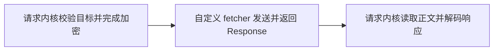

# 自定义 fetcher 与网络代理

SDK 通过 `config.fetcher` 提供统一的传输层依赖注入点。当需要经由代理服务器转发请求、接入自定义网络客户端、记录统一日志埋点或编写单元测试桩时，均可传入自定义 `fetcher`。

自 v8.0.0 起，SDK 不再内置 `proxy` 配置项。在模块配置或 `createRequest` 中传入 `proxy` 会在发送请求前明确拒绝（`status: 400`、`failure.kind === 'invalidRequest'`）。

## 自定义 fetcher

`FetchLike` 与标准 `fetch` 拥有相同的函数签名，`createHanaMusicApi`、`createClient`、具名函数、`invokeModule` 与 `createRequest` 均支持传入。

```ts
import { createHanaMusicApi, type FetchLike } from 'hana-music-api';

const customFetcher: FetchLike = (input, init) => fetch(input, init);
const hana = createHanaMusicApi({ fetcher: customFetcher });

const result = await hana.search({ keywords: '海阔天空' });
console.log(result.body);
```

自定义 `fetcher` 仅替换实际的 HTTP 传输发送环节。目标域名校验、参数加密以及响应解密解码仍由 SDK 请求内核完成。



## 实现约束

编写或封装自定义 `fetcher` 时，必须遵守以下传输契约：

- **透传 `init.signal`**：必须将 `init.signal` 传入底层请求，并确保响应体的可读流支持中断。若自定义实现忽略信号而在后台继续联网，外层触发取消或超时时 SDK 仅能释放自身等待资源，无法强制中止底层请求。
- **正文读取计入超时**：`fetcher` 返回 `Response` 时传输尚未结束。请求内核读取完整响应正文的耗时同样受调用总超时时间 `timeoutMs` 约束。
- **遵守 `redirect: 'manual'`**：请求内核会显式传入 `redirect: 'manual'` 并拒绝 3xx 重定向响应。自定义实现不得自动跟随重定向，以免绕过安全域名校验。

## 常见用法示例

### Node.js 通过代理发送请求

在 Node.js 环境中安装 `undici` 后，可创建复用连接池的 `ProxyAgent` 并通过自定义 `fetcher` 传入。请确保传入的 `init.signal` 与 `redirect: 'manual'` 原样交给 `undici.fetch`。

```ts
import { createHanaMusicApi, type FetchLike } from 'hana-music-api';
import { fetch as undiciFetch, ProxyAgent } from 'undici';

const agent = new ProxyAgent('http://127.0.0.1:7890');

const proxyFetcher: FetchLike = (input, init) =>
  undiciFetch(input, {
    ...init,
    dispatcher: agent,
  } as Parameters<typeof undiciFetch>[1]) as unknown as Promise<Response>;

const hana = createHanaMusicApi({ fetcher: proxyFetcher });
const result = await hana.search({ keywords: '海阔天空' });
console.log(result.body);

// 应用关闭前释放代理连接池
await agent.destroy();
```

### Bun 通过代理发送请求

Bun 原生 `fetch` 支持非标准 `proxy` 选项，可在 `fetcher` 中透传该选项并保留其余参数。

```ts
import { createHanaMusicApi, type FetchLike } from 'hana-music-api';

const bunProxyFetcher: FetchLike = (input, init) =>
  fetch(input, {
    ...init,
    proxy: 'http://127.0.0.1:7890',
  } as RequestInit);

const hana = createHanaMusicApi({ fetcher: bunProxyFetcher });
const result = await hana.search({ keywords: '海阔天空' });
console.log(result.body);
```

### 记录请求耗时

在自定义 `fetcher` 中包装 `fetch`，可以记录包含完整请求头和真实出口状态的响应头到达耗时：

```ts
import { createHanaMusicApi, type FetchLike } from 'hana-music-api';

const loggingFetcher: FetchLike = async (input, init) => {
  const url = new URL(input instanceof Request ? input.url : String(input));
  const startedAt = performance.now();
  const response = await fetch(input, init);

  console.log({
    target: `${url.origin}${url.pathname}`,
    status: response.status,
    headersReceivedMs: performance.now() - startedAt,
  });
  return response;
};

const hana = createHanaMusicApi({ fetcher: loggingFetcher });
await hana.search({ keywords: '海阔天空' });
```

> [!NOTE]
> 此处统计的是收到响应头为止的单次网络耗时，不包含后续流式正文读取、身份准备及重试退避。需要追踪重试与完整调用耗时，请参见 [调试与事件观测](/guide/observability)。

### 单元测试假响应

在本地测试中注入 `fetcher` 可以隔离真实网络依赖，同时验证模块的参数编码与响应解码逻辑：

```ts
import { expect, test } from 'bun:test';

import { songUrl, type FetchLike } from 'hana-music-api';

const stub: FetchLike = async () => Response.json({ code: 200, data: [] });

test('songUrl 使用假响应', async () => {
  const result = await songUrl(
    { ids: [1] },
    { fetcher: stub, cookie: 'MUSIC_A=test-token' },
  );
  expect(result.status).toBe(200);
});
```

- **测试身份设置**：未提供会话凭据时，隐式匿名注册请求同样会发往 `fetcher`。测试业务接口时建议传入 `cookie: 'MUSIC_A=test-token'` 跳过注册，测试注册流程时假响应需返回包含 `MUSIC_A` 的 `Set-Cookie` 响应头。
- **正文解码覆盖**：假响应同样会经过完整响应解码与业务结构校验，但本地桩响应通过测试不能代表真实上游接口当前可用。
