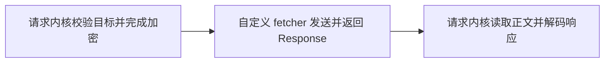

# HTTP 代理与自定义 fetcher

当请求需要经由代理服务器转发，或需要接入自定义网络客户端、统一日志埋点与单元测试桩时，可通过 `proxy` 或 `fetcher` 控制传输层行为。普通调用无需额外配置。

## 配置 HTTP 代理

使用简单 HTTP 代理时，直接在执行配置中传入 `proxy` 地址即可：

```ts
import { search } from 'hana-music-api';

const result = await search(
  { keywords: '海阔天空' },
  { proxy: 'http://127.0.0.1:7890' },
);
console.log(result.body);
```

- **Bun 环境**：默认使用 `Bun.fetch` 原生支持的 `proxy` 参数，无需安装额外依赖。
- **Node.js 环境**：通过可选对等依赖 `undici` 的 `ProxyAgent` 转发请求，并在单次尝试完成后销毁代理实例。若 Node.js 下未安装 `undici` 而传入 `proxy`，调用会立即以 `status: 400`（`failure.kind === 'invalidRequest'`）拒绝。

使用 `proxy` 时有以下限制：

- **不支持 PAC 脚本**：必须明确指定 HTTP 代理服务器地址。
- **不可与 `fetcher` 同时传入**：同时配置 `proxy` 与自定义 `fetcher` 会在执行前被拒绝（`status: 400`）。
- **不静默降级直连**：代理连接失败时会直接报错返回，不会自动回退为直连请求。
- **高级网络需求**：需要 SOCKS 代理、mTLS 双向认证或自定义长连接池时，请使用自定义 `fetcher` 对接专业网络库。

## 自定义 fetcher

`FetchLike` 与标准 `fetch` 拥有相同的函数签名，`createHanaMusicApi`、`createClient`、具名函数、`invokeModule` 与 `createRequest` 均支持传入。

```ts
import { createHanaMusicApi, type FetchLike } from 'hana-music-api';

const customFetcher: FetchLike = (input, init) => fetch(input, init);
const hana = createHanaMusicApi({ fetcher: customFetcher });

const result = await hana.search({ keywords: '海阔天空' });
console.log(result.body);
```

自定义 `fetcher` 仅替换实际的 HTTP 传输发送环节，目标域名检查、参数加密以及响应解密解码仍由 SDK 请求内核完成。



## 实现约束

编写或封装自定义 `fetcher` 时，必须遵守以下传输契约：

- **透传 `init.signal`**：必须将 `init.signal` 传入底层请求，并确保响应体的可读流支持中断。若自定义实现忽略信号而在后台继续联网，外层触发取消或超时时 SDK 仅能释放自身等待资源，无法强制中止第三方请求。
- **正文读取计入超时**：`fetcher` 返回 `Response` 时传输尚未结束，请求内核读取完整响应正文的耗时同样受调用总超时时间 `timeoutMs` 约束。
- **遵守 `redirect: 'manual'`**：请求内核会显式传入 `redirect: 'manual'` 并拒绝 3xx 重定向响应，自定义实现不得自动跟随重定向以防绕过安全域名校验。

## 常见用法示例

### 记录请求耗时

在自定义 `fetcher` 中包装 `fetch`，可以记录包含完整请求头和真实出口状态的响应头到达耗时：

```ts
import { createHanaMusicApi, type FetchLike } from 'hana-music-api';

const loggingFetcher: FetchLike = async (input, init) => {
  const url = new URL(input instanceof Request ? input.url : String(input));
  const startedAt = performance.now();
  const response = await fetch(input, init);

  console.log({
    target: `${url.origin}${url.pathname}`,
    status: response.status,
    headersReceivedMs: performance.now() - startedAt,
  });
  return response;
};

const hana = createHanaMusicApi({ fetcher: loggingFetcher });
await hana.search({ keywords: '海阔天空' });
```

> [!NOTE]
> 此处统计的是收到响应头为止的单次网络耗时，不包含后续流式正文读取、身份准备及重试退避。需要追踪重试与完整调用耗时，请参见 [调试与可观测性](/guide/observability)。

### 单元测试假响应

在本地测试中注入 `fetcher` 可以隔离真实网络依赖，同时验证模块的参数编码与响应解码逻辑：

```ts
import { expect, test } from 'bun:test';

import { songUrl, type FetchLike } from 'hana-music-api';

const stub: FetchLike = async () => Response.json({ code: 200, data: [] });

test('songUrl 使用假响应', async () => {
  const result = await songUrl(
    { ids: [1] },
    { fetcher: stub, cookie: 'MUSIC_A=test-token' },
  );
  expect(result.status).toBe(200);
});
```

- **测试身份设置**：未提供会话凭据时，隐式匿名注册请求同样会发往 `fetcher`。测试业务接口时建议传入 `cookie: 'MUSIC_A=test-token'` 跳过注册，测试注册流程时假响应需返回包含 `MUSIC_A` 的 `Set-Cookie` 响应头。
- **正文解码覆盖**：假响应同样会经过完整响应解码与业务结构校验，但本地桩响应通过测试不能代表真实上游接口当前可用。
