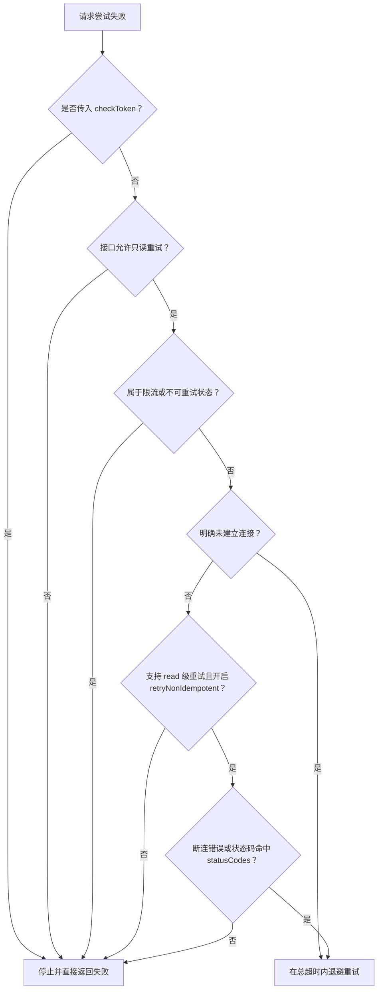

# 超时、取消与重试

一次 SDK 调用的总耗时涵盖身份准备、请求发送、重试退避以及读取完整响应正文。通过 `timeoutMs`、`signal`、`retry` 和 `connectionStrategy`，可以对每次调用的容错边界进行精确控制。

## 超时管理

`timeoutMs` 限制单次调用从开始到返回结果的总超时时间，发生重试时计时不会重置。即使上游已经返回响应头，读取完整响应正文的过程依然受总超时时间约束。


| 调用类型                       | 默认超时时间                 | 配置规则                                |
| ------------------------------ | ---------------------------- | --------------------------------------- |
| 标准模块                       | `8000` 毫秒（8 秒）          | 传入 `0` 或负数可关闭总超时             |
| 上传模块（如云盘、声音、头像） | 总计 `300000` 毫秒（5 分钟） | 单阶段上限 `60000` 毫秒，不可关闭总超时 |
| 底层请求 `createRequest`       | `8000` 毫秒（8 秒）          | 传入 `0` 或负数可关闭总超时             |
| HTTP 服务读取客户端请求体      | `5000` 毫秒（5 秒）          | 仅作用于 HTTP 入口，超时返回 `408`      |

- **关闭总超时**：普通模块调用与 `createRequest` 传入 `timeoutMs: 0` 或负数时，不启用总超时限制。
- **上传上限约束**：上传模块无法通过 `timeoutMs: 0` 或负数取消 5 分钟总上限。传入正数时，总超时时间取配置值与 5 分钟的较小值，且每个上传阶段仍受 60 秒与剩余总时间的双重限制。
- **超时错误形态**：超出总超时时间后，SDK 以 `status: 504`（`failure.kind === 'timeout'`）拒绝 Promise。HTTP 服务端的请求体读取超时（`408`）与模块执行超时（`504`）相互独立，详情参见 [部署 HTTP 服务](/guide/http-deployment)。

## 主动取消

可以通过标准 `AbortController` 向任意调用传入 `signal`，在外部条件变化时主动中断等待。

```ts
import { createHanaMusicApi } from 'hana-music-api';

const hana = createHanaMusicApi({ cookie: 'MUSIC_U=your-cookie' });
const controller = new AbortController();

const pending = hana.search(
  { keywords: '海阔天空' },
  { signal: controller.signal, timeoutMs: 5000 },
);

controller.abort();
await pending.catch((error: unknown) => console.log(error));
```

- **取消状态映射**：主动取消会拒绝为 `status: 499`（`failure.kind === 'cancelled'`），完整错误判定见 [错误处理](/guide/error-handling)。
- **并发请求去重下的取消**：多个调用方同时等待同一个共享读取时，单个调用方取消或超时只会结束自身的等待。只有当最后一个等待者也离开后，内核才会中断底层上游请求，详见 [缓存与身份池](/guide/cache-and-identity-pool#并发请求去重的取消行为)。
- **自定义传输配合**：传入自定义 `fetcher` 时，实现内部必须透传 `init.signal` 并支持流式正文取消，详见 [HTTP 代理与自定义 fetcher](/guide/proxy-and-fetcher#实现约束)。
- **HTTP 客户端断开**：在自建 HTTP 服务中，客户端连接中断的取消信号会自动传入模块执行。

## 重试策略

是否允许重试首先取决于接口内置的请求策略，其次取决于具体的失败原因。写操作、登录、轮询、批量、上传以及底层 `createRequest` 均不参与自动重试。



- **建连失败默认重试**：对于允许只读或建连重试的接口，遇到 `ECONNREFUSED`、`EAI_AGAIN` 或连接建立超时（`UND_ERR_CONNECT_TIMEOUT`、`connect ETIMEDOUT`）等明确未建立连接的失败时，默认最多尝试 `3` 次（即最多重试 2 次）。
- **明确读接口额外重试**：对于支持读重试的接口（如 [search](/api/search/search)、[lyric](/api/music/lyric)、[songDetail](/api/music/song-detail)、[playlistDetail](/api/playlist/playlist-detail) 及播放列表与搜索辅助读接口），可通过 `retry.retryNonIdempotent: true` 开启连接中断及指定状态码重试。
- **不可重试场景**：传入 `checkToken` 后禁用自动重试。状态码 `429`、`405`（限流）、`499`、`503` 和 `504` 均不会被重试策略再次发送。

```ts
import { lyric } from 'hana-music-api';

const result = await lyric(
  { id: '347230' },
  {
    retry: {
      retryNonIdempotent: true,
      retries: 2,
      backoffMs: 300,
      maxBackoffMs: 2000,
      jitter: true,
      statusCodes: [502],
    },
  },
);
console.log(result.body);
```

| 配置字段             | 类型                    | 默认值  | 说明                                                              |
| -------------------- | ----------------------- | ------- | ----------------------------------------------------------------- |
| `retryNonIdempotent` | `boolean`               | `false` | 为支持读重试的接口开启额外重试（对写操作与 `createRequest` 无效） |
| `retries`            | `number`                | `2`     | 开启额外重试时的最大重试次数，取值范围为 `0` 至 `5`               |
| `backoffMs`          | `number`                | `300`   | 首次重试的基础退避时间（毫秒），后续按指数增长                    |
| `maxBackoffMs`       | `number`                | `2000`  | 抖动计算前的退避基数上限（毫秒）                                  |
| `jitter`             | `boolean`               | `true`  | 是否在退避基数上叠加随机抖动（`0.5` 至 `1.5` 倍）                 |
| `statusCodes`        | `ReadonlyArray<number>` | 无      | 额外重试时允许触发重试的失败状态码列表                            |

> [!NOTE]
> 未设置 `retryNonIdempotent: true` 时，单独调整 `retries` 不会改变建连失败默认最多尝试 3 次的规则。所有退避等待时间同样受总 `timeoutMs` 与 `signal` 限制。

## 连接策略

通过 `connectionStrategy` 控制是否在请求头中附加 `Connection: close`，可选值见下表（配置入口见 [执行配置](/guide/config)）。

| 策略值             | 行为说明                                                                 |
| ------------------ | ------------------------------------------------------------------------ |
| `'default'`        | 首次尝试使用运行时默认连接复用行为，重试时附加 `Connection: close`       |
| `'close'`          | 每次请求尝试均附加 `Connection: close`                                   |
| `'fresh-on-retry'` | 首次使用默认行为，重试时附加 `Connection: close`（当前等同 `'default'`） |

> [!TIP]
> 请求头并不能完全接管底层传输层的连接池调度。如果需要精细控制连接池生命周期或复用心跳，应通过自定义 `fetcher` 接入专用网络客户端。

## 限流与频率控制

SDK 不会在本地执行排队或限速逻辑。当某次请求触发网易云限流时，SDK 不会阻塞、延迟或拒绝同一进程中的后续其他调用，每次调用都会立即发送至上游。

| 触发条件                                                    | SDK 识别状态 | `failure.kind`  |
| ----------------------------------------------------------- | ------------ | --------------- |
| 响应 HTTP 状态码为 `429`                                    | `429`        | `'rateLimited'` |
| 响应正文 `code` 为 `429`                                    | `429`        | `'rateLimited'` |
| 响应正文 `code` 为 `405` 且提示含“操作频繁”或“操作过于频繁” | `405`        | `'rateLimited'` |

- **业务 405 的区分**：不依赖 HTTP 状态码判断正文 `code`，即使上游以 HTTP 200 返回含“操作频繁”的业务码 `405`，SDK 仍会以 `status: 405` 拒绝并附带 `retryAfter`。其他不包含频控提示的 `405` 视为普通业务拒绝（`failure.kind === 'business'`），不会补加 `retryAfter`。
- **`retryAfter` 计算规则**：优先解析上游响应的 `Retry-After` 响应头（支持秒数或标准 HTTP 日期），结果钳位在 `1` 至 `300` 秒（1 秒至 5 分钟）之间。缺少响应头或格式无效时默认提供 `30` 秒，通过 `failure.retryAfter` 与 `body.retryAfter` 暴露，HTTP 服务同时写回 `Retry-After` 响应头。
- **调用方频控建议**：批量采集或高频同步任务应在应用层限制并发数、插入请求间隔，并在收到 `rateLimited` 失败后按 `retryAfter` 退避等待。
- **HTTP 入口限流差异**：自建 HTTP 服务内置按来源 IP 与并发配额计算的入口限流，仅保护 HTTP 对外接口，不作用于进程内直接调用的 SDK，详见 [部署 HTTP 服务](/guide/http-deployment)。
