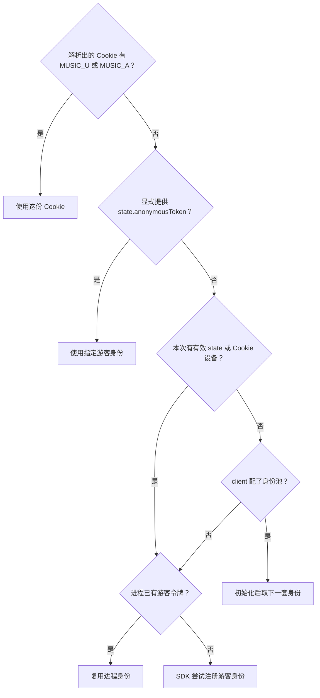

# 运行时状态与身份

登录 Cookie 之外，请求还会带设备号、客户端版本和来源 IP 请求头。库会准备这些协议字段。通常只需传有效 Cookie，需要隔离多账号或测试环境时再按次覆盖。

## 运行时保存什么

```ts
interface RuntimeState {
  anonymousToken: string;
  cnIp: string;
  deviceId: string;
}
```

进程初始化时只生成默认设备号和中国地区 IP 字符串，匿名令牌为空，不读写任何本地文件，因此 SDK 可以直接跑在随时回收的 Serverless 函数里。HTTP 服务的 CLI 启动阶段会另外从令牌文件读取匿名令牌，见 [部署 HTTP 服务](/guide/server-deployment)。

这些值用于构造客户端协议身份，不表示真实设备或真实出口 IP，也不保证上游一定接受请求。

## 这次调用用哪个身份

普通模块从 `config.cookie` 取得本次会话，不能通过任意 headers 覆写身份。显式低层 `createRequest` 仍保留原始头：显式 cookie 优先，缺少时读取不区分大小写的 Cookie 头。



这张图说明需要 API 会话的 SDK 调用怎样选择凭据。纯本地和仅 plain 的动作不会为此注册身份。HTTP 的 CLI 启动阶段会准备匿名令牌，直接 `createRequest` 则只使用提供的配置和当前运行时状态，不自动触发 SDK 的身份初始化。

设备单独按有效的 `state.deviceId`、旧 Cookie 的 `deviceId`、已有匿名或运行时设备的顺序选择。调用方提供的设备不会被身份池覆盖；空白或 `undefined` 也不会抹掉池已选定的设备。身份准备好后，调用保存一份快照。之后进程状态变化，不会中途改掉这次调用的身份。缓存也根据有效身份区分请求。

## Cookie 会怎样整理

普通模块的客户端身份由动作声明固定。请求层在加密前一次生成 UA、平台、版本和渠道，清除旧平台字段及大小写变体，再合入本次会话与设备。EAPI 使用已有 iPhone 组合，weapi 浏览器动作用干净 web 组合；clientlog 保留配套的 macOS 字段。没有可靠来源的 buildver、versioncode、机型和分辨率会省略，EAPI Cookie 与加密内头从同一组值生成。

显式低层 `createRequest` 保留原始选项。未指定平台时，eapi/api 默认 iPhone、weapi 默认 web、linuxapi 默认 Linux；只指定已知 `cookie.os` 时，未提供的字段也按这个平台配套。未知平台不猜 UA 或版本，明确传入的原始 UA/字段仍由调用者负责。请求标识等字段仍会生成或重写，Cookie 也不是原样透传。

没有账号 `MUSIC_U`、也没有游客 `MUSIC_A` 时，若运行时快照中有匿名令牌，就会补入 `MUSIC_A`。

## 来源 IP 请求头

SDK 的来源 IP 按以下顺序选择：

```text
realIP > ip > state.cnIp 或进程 cnIp
```

```ts
import { songUrl } from 'hana-music-api';

const result = await songUrl({ id: '347230' }, { realIP: '116.25.146.177' });
console.log(result.body);
```

它改变的是 `X-Forwarded-For` 和 `X-Real-IP`，不会改变网络出口。需要真实代理时，用 `proxy` 或自定义 `fetcher`。

HTTP 服务根据连接地址和可信代理配置确定来源，不接受客户端传入 `ip` 或 `realIP` 执行配置。无法取得来源或来源是 IPv6 loopback 等情况时，服务可能回退到运行时 IP，详见 [部署 HTTP 服务](/guide/server-deployment)。

## 首次注册怎样等待

SDK 缺少身份时，只有有效设备相同的并发调用才共用一次注册，设备不同不会合并初始化。注册成功后更新进程运行时状态，后续可直接复用。SDK 的这次懒初始化只更新内存，CLI 的令牌生成流程才负责文件保存。

初始化等待计入模块总期限。一个等待者取消，不影响仍在等的调用；最后一个等待者也取消时，会中断共享注册。失败后允许后续调用再次尝试。

注册请求也经过同一个请求内核。自定义 `fetcher` 会收到注册请求，测试只关注业务接口时，可提供 `MUSIC_A=test-token` 这样的测试身份。

## 匿名注册的设备号

```ts
import { createHanaMusicApi, generateDeviceId } from 'hana-music-api';

const deviceId = generateDeviceId();
const hana = createHanaMusicApi({ state: { deviceId } });
const result = await hana.loginQrKey();
console.log(result.body);
```

`generateDeviceId(): string` 返回 52 位大写十六进制设备号，并排除会导致匿名注册返回 `code: 400` 的候选值。SDK 隐式注册、运行时默认设备号和 CLI 注册都使用同一生成规则。本次没有显式设备时，隐式注册沿用已有匿名或进程默认设备；明确传入的有效 `state.deviceId` 不会被旧 Cookie 或运行时设备替换。

如果由调用方生成设备号，合格条件是：设备号与字符串 `3go8&$8*3*3h0k(2)2` 循环逐字符异或，将结果按 UTF-8 编码后计算 MD5，再转为标准 Base64；这份摘要不能包含 `+` 或 `/`。注册用户名仍为 `base64(deviceId + ' ' + digest)`，不改用 Base64URL。仅仅是十六进制字符串并不保证合格，建议直接调用公开生成器。

旧顶层 `ModuleCallConfig.deviceId` 已在 major 配置收口中移除，改用 `state.deviceId`。调用方生成一次并保存，后续复用同一设备；真实登录或续期返回的 Cookie 仍由调用方决定怎样保存和继续传入。

## 按次覆盖运行时状态

```ts
import { songUrl } from 'hana-music-api';

const result = await songUrl(
  { id: '347230' },
  {
    state: {
      anonymousToken: 'token-for-this-call',
      cnIp: '116.25.146.177',
      deviceId: 'device-for-this-call',
    },
  },
);
console.log(result.body);
```

`state` 在本次调用中覆盖进程默认值，不会把这些覆盖值写回全局状态。显式账号 Cookie 仍比游客令牌优先。

运行时读写函数属于内部实现，不从 SDK 根入口导出。自动轮换多套游客身份的用法见 [缓存与身份池](/guide/sdk-cache-and-identity-pool)。
