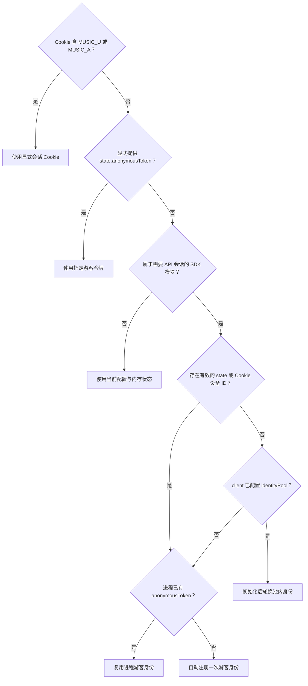

# 运行时状态与身份

除账号登录 Cookie 外，网易云接口请求还依赖设备 ID、客户端平台信息与来源 IP 请求头。SDK 会在进程内存中按需维护这些运行时字段，多账号隔离或测试场景可通过单次配置覆盖。

## 运行时状态

SDK 通过 `RuntimeState` 结构保存当前进程的默认游客上下文：

```ts
interface RuntimeState {
  anonymousToken: string;
  cnIp: string;
  deviceId: string;
}
```

- **延迟初始化**：模块导入阶段不会立即创建状态。首次读取运行时状态时，内核才在内存中生成默认的 `deviceId` 与随机中国地区 IP 字符串 `cnIp`，并将 `anonymousToken` 置空。
- **无本地文件读写**：SDK 核心运行时不读写本地磁盘文件，适合运行在按需销毁的 Serverless 环境中。自建 HTTP 服务 CLI 启动前会另行读取或生成令牌文件，详见 [部署 HTTP 服务](/guide/http-deployment)。
- **协议用途边界**：这些字段仅用于构造网易云客户端协议标识，不代表真实硬件设备或实际出口网络地址。

## 身份解析优先级

标准模块从 `config.cookie` 获取会话凭据，不能通过任意请求头注入 Cookie。显式底层 `createRequest` 优先读取 `options.cookie`，缺失时回退读取不区分大小写的 `headers.Cookie`。



- **凭据优先级**：解析出的身份严格按 `MUSIC_U` → `MUSIC_A` → `state.anonymousToken` → 身份池（无显式设备 ID 时） → 进程 `anonymousToken` → 隐式注册顺序确定。
- **设备 ID 解析顺序**：设备 ID 按 `state.deviceId` → `cookie.deviceId` → 进程默认 `deviceId` 的顺序选取首个有效值（非空且不含空白或控制字符）。使用 `identityPool` 时，由池内分配条目的设备 ID 接管。
- **调用隔离快照**：每次调用在开始阶段生成不可变的身份快照。请求执行期间即使进程状态更新，也不会中途改变当前调用已锁定的身份。
- **底层请求差异**：`createRequest` 与纯直链动作不会触发 SDK 的隐式游客注册或身份池初始化，仅直接使用传入选项与当前内存中的 `RuntimeState`。

## 客户端平台字段清理与生成

标准模块与底层 `createRequest` 对客户端平台标识采取不同的处理规则：

- **标准模块固定平台**：标准模块遵循各自的接口默认协议与客户端身份（例如 `eapi` 默认使用 iPhone 标识、`weapi` 默认使用 Web 浏览器标识、`clientlog` 使用 macOS 标识）。在加密前，请求层会清除调用方 Cookie 中残留的 `os`、`appver`、`channel`、`osver`、`buildver`、`mobilename`、`versioncode`、`resolution` 等旧平台字段及大小写变体，统一生成配套的协议 Cookie 与 `User-Agent`。
- **底层 `createRequest` 平台匹配**：未提供 `cookie.os` 时，`weapi` 默认匹配 Web、`linuxapi` 默认匹配 Linux、`eapi` 与 `api` 默认匹配 iPhone。传入已知 `pc`、`android`、`linux`、`osx`、`web`、`iphone` 或 `iPhone OS` 时会补齐缺省平台字段，未知平台名不自动补充默认 UA。
- **防重放字段生成**：无论采用标准模块还是 `createRequest`，请求层均会自动生成 `__remember_me`、`_ntes_nnid`、`_ntes_nuid`、`WEVNSM`、`WNMCID`、`deviceId` 与 `NMTID` 等会话参数。
- **游客令牌补齐**：若请求未携带 `MUSIC_U` 或 `MUSIC_A`，且解析后的运行时快照包含 `anonymousToken`，请求层会在发送前自动补入 `MUSIC_A`。

## 来源 IP 请求头

SDK 按以下顺序决定写往上游的来源 IP 请求头：

```text
realIP > ip > state.cnIp（或进程默认 cnIp）
```

```ts
import { songUrl } from 'hana-music-api';

const result = await songUrl({ ids: [347230] }, { realIP: '116.25.146.177' });
console.log(result.body);
```

- **仅作用于请求头**：该设置仅影响发往上游的 `X-Forwarded-For` 与 `X-Real-IP` 请求头，不会改变真实网络出口。需要代理流量路由请参考 [HTTP 代理与自定义 fetcher](/guide/proxy-and-fetcher)。
- **HTTP 服务来源解析**：自建 HTTP 服务拒绝客户端直接传入 `ip` 或 `realIP` 参数（返回 `400`），改为依据实际连接地址及 `trustedProxyIps` 配置获取来源 IP。无法识别来源或遇到 `::1` 回环地址时回退至运行时 `cnIp`，详见 [部署 HTTP 服务](/guide/http-deployment)。

## 匿名身份初始化

当进程尚未具备可用凭据且需要发起会话请求时，SDK 会自动调用网易云匿名注册接口获取 `MUSIC_A`。

- **同设备并发合并**：并发发起的无身份调用中，只有解析出相同 `deviceId` 且使用同一 `fetcher` 的调用会共用一次注册请求。设备 ID 或 `fetcher` 不同时会各自独立注册。
- **内存状态更新**：匿名注册成功后会更新进程内存中的 `RuntimeState` 供后续调用复用，不会写入本地磁盘。
- **期限与取消**：初始化等待计入当前调用的 `timeoutMs`。单个调用方取消不会影响其他正在等待同一注册的调用，全部等待者离开后才会中断注册。初始化失败后，后续调用仍可重新触发注册。
- **测试环境跳过**：隐式注册同样经过标准传输内核与自定义 `fetcher`。若单元测试仅关注业务接口，可直接传入测试令牌（如 `cookie: 'MUSIC_A=test-token'`）跳过隐式注册。

## 设备 ID 生成与复用

SDK 导出 `generateDeviceId()` 工具函数，用于生成符合网易云匿名注册要求的随机设备 ID。

```ts
import { createHanaMusicApi, generateDeviceId } from 'hana-music-api';

const deviceId = generateDeviceId();
const hana = createHanaMusicApi({ state: { deviceId } });

const result = await hana.loginQrKey();
console.log(result.body);
```

- **生成格式与规则**：`generateDeviceId()` 返回 52 位大写十六进制字符串，并确保排除会在匿名注册时触发 `code: 400` 拒绝的候选值。
- **自定义设备 ID 校验条件**：自行生成的设备 ID 须不含空白与控制字符，且与密钥 `3go8&$8*3*3h0k(2)2` 循环异或后计算的 UTF-8 MD5 标准 Base64 摘要中不能包含 `+` 或 `/`。推荐直接调用 `generateDeviceId()` 并由业务侧保存。
- **配置迁移说明**：v7 已移除顶层 `deviceId` 执行配置，请统一改用 `state: { deviceId }`，参见 [配置参考](/guide/config) 与 [从 6.x 升级到 7.x](/guide/migrating-to-v7)。

## 单次覆盖运行时状态

可在单次调用的 `config.state` 中传入临时状态覆盖进程默认值，不会污染全局状态。

```ts
import { songUrl } from 'hana-music-api';

const result = await songUrl(
  { ids: [347230] },
  {
    state: {
      anonymousToken: 'token-for-this-call',
      cnIp: '116.25.146.177',
      deviceId: 'device-for-this-call',
    },
  },
);
console.log(result.body);
```

- **单次作用域**：`state` 仅在当前调用的不可变快照中生效，不会写回进程级 `RuntimeState`。
- **账号优先**：若同时传入了显式账号 `MUSIC_U` Cookie，账号身份仍优先于 `state.anonymousToken`。
- **多游客轮换**：需要自动轮换多套游客身份，请参阅 [缓存、并发去重与身份池](/guide/cache-and-identity-pool)。
