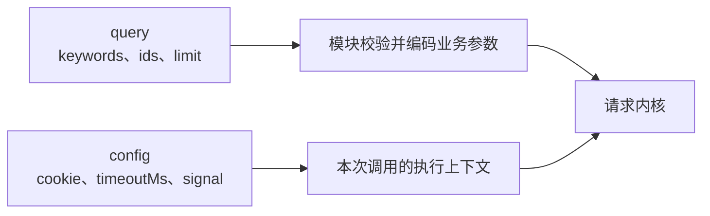

# SDK 调用方式

SDK 全部模块均返回 Promise，并统一将业务参数与执行配置拆分为两个独立参数传入。从 6.x 升级请先阅读 [从 6.x 升级到 7.x](/guide/migrating-to-v7)。

## 调用方式概览

| 调用方式             | 导入来源                               | 适用场景                                             |
| -------------------- | -------------------------------------- | ---------------------------------------------------- |
| `createClient` 组合  | `hana-music-api/core` + `./api/*`      | 生产服务、Serverless 函数，需最小体积与共享缓存/配置 |
| `createHanaMusicApi` | `hana-music-api`                       | 需要在一个实例上访问全部 352 个接口并共享默认配置    |
| 单模块具名函数       | `hana-music-api/api/<module>` 或根入口 | 脚本或仅调用个别接口，无需共享客户端配置             |
| `invokeModule`       | `hana-music-api`                       | 运行时动态拼装或路由模块标识符                       |

### 1. 按需组合客户端（推荐）

从 `hana-music-api/api/<module>` 导入所需接口，再用 `createClient` 绑定默认配置、读取缓存与身份池。打包产物仅包含传入的模块。

```ts
import { search } from 'hana-music-api/api/search';
import { songUrlV1 } from 'hana-music-api/api/song_url_v1';
import { createClient } from 'hana-music-api/core';

const hana = createClient(
  { search, songUrlV1 },
  {
    cookie: 'MUSIC_U=your-cookie',
    cache: { enabled: true },
    timeoutMs: 8000,
  },
);

const searchResult = await hana.search({ keywords: '周杰伦', limit: 5 });
const songResult = await hana.songUrlV1({ ids: [347230], level: 'standard' });

console.log(searchResult.body, songResult.body);
```

`createClient` 构造时会同步校验配置对象与传入模块映射。若传入非法配置键或非 SDK 模块函数，会立即同步抛出 `TypeError`。

### 2. 全量客户端

需要在一个客户端实例上调用全部 352 个接口时，使用 `createHanaMusicApi`：

```ts
import { createHanaMusicApi } from 'hana-music-api';

const hana = createHanaMusicApi({
  cookie: 'MUSIC_U=your-cookie',
  timeoutMs: 8000,
});

const searchResult = await hana.search({ keywords: '周杰伦', limit: 5 });
const songResult = await hana.songUrl({ ids: [347230], br: 320000 });

console.log(searchResult.body, songResult.body);
```

单次调用时可传入第二个参数覆盖默认配置。覆盖按顶层字段浅合并，例如传入新的 `state` 对象会整体替换客户端默认 `state`。

```ts
await hana.search({ keywords: '林俊杰' }, { timeoutMs: 5000 });
```

### 3. 单模块具名函数

子路径使用下划线模块名，导出函数使用驼峰命名。例如 HTTP `/song/url` 对应 `hana-music-api/api/song_url` 导出的 `songUrl`：

```ts
import { songUrl } from 'hana-music-api/api/song_url';

const result = await songUrl(
  { ids: [347230] },
  { cookie: 'MUSIC_U=your-cookie' },
);

console.log(result.body);
```

- **已建模接口子路径**：同时导出具名函数、输入类型（如 `SongDetailInput`）和运行时校验器（如 `SongDetailBody`）。
- **未建模接口子路径**：仅导出具名函数与输入类型，返回正文类型为 `UnknownJson`。

### 4. 按模块名动态调用

需要在运行时根据名称动态分派模块时，使用 `invokeModule(identifier, query, config)`。模块标识采用下划线形式，对应 TypeScript 类型为 `ModuleIdentifier`。

```ts
import { invokeModule } from 'hana-music-api';

const result = await invokeModule(
  'user_account',
  {},
  { cookie: 'MUSIC_U=your-cookie' },
);

console.log(result.body);
```

## 业务参数传递规范



- **原生类型传参**：直接传入数组、对象、数字或布尔值，不要手工拼接逗号分隔字符串、分号串或 JSON 字符串。
- **严格字段校验**：每个模块均定义了精确的输入结构，未声明字段、错位放置的执行配置键或非法 ID 会在发送前以 `status: 400` 拒绝。
- **执行配置隔离**：`config` 接收 `ModuleCallConfig` 字段，详见 [执行配置](/guide/config)。

```ts
await hana.songDetail({ ids: [347230, '347231'] });
await hana.playlistTracks({ op: 'add', pid: 24381616, tracks: [347231] });
await hana.playlistTagsUpdate({ id: 24381616, tags: ['学习', '夜晚'] });
await hana.songOrderUpdate({ pid: 24381616, ids: [111, 222] });
```

## 传递 checkToken 与歌单曲目分步操作

### 可选传递 checkToken

所有 SDK 模块均支持在 `config` 中传入 `checkToken`，用于传递由前端行为验证取得的易盾令牌。

```ts
import { createHanaMusicApi } from 'hana-music-api';

const hana = createHanaMusicApi({ cookie: 'MUSIC_U=your-cookie' });
await hana.albumSub({ id: 32311, t: 1 }, { checkToken: 'single-use-token' });
await hana.artistSub({ id: 6452, t: 0 }, { checkToken: getFreshCheckToken });
```

- **单次字符串与异步函数**：单请求接口可传固定字符串，同一次调用需发起多次业务请求的场景必须传异步函数 `() => Promise<string>`。
- **执行策略限制**：传入 `checkToken` 时自动关闭该次调用的缓存、并发请求去重与自动重试，等待取值的耗时计入总超时时间。
- **浏览器采集**：浏览器端通过 `hana-music-api/watchman` 获取 token 并经自有服务端路由透传给 SDK，用法见 [浏览器 Watchman](/guide/watchman)。

### 歌单曲目 512 后的分步操作

`playlistTracks` 默认在首次请求返回业务码 `512` 时自动发起一次后备请求。若 token 在浏览器生成且仅支持单次消费，可通过 `step` 参数将两步拆分为两次独立调用：

```ts
import { getNcmFailureInfo, playlistTracks } from 'hana-music-api';

const changeTracks = async (getFreshToken: () => Promise<string>) => {
  const input = { op: 'add' as const, pid: 24381616, tracks: [347231] };
  const config = { cookie: 'MUSIC_U=your-cookie' };
  try {
    return await playlistTracks(
      { ...input, step: 'initial' },
      { ...config, checkToken: await getFreshToken() },
    );
  } catch (error) {
    const failure = getNcmFailureInfo(error);
    if (failure?.kind !== 'business' || failure.code !== 512) throw error;
  }
  return playlistTracks(
    { ...input, step: 'fallback' },
    { ...config, checkToken: await getFreshToken() },
  );
};
```

- **两步各自独立**：每步均需各自传入有效 Cookie、设备状态与取消信号，SDK 不在步骤间保存会话或合并首次失败的 Cookie。
- **无事务保证**：后备请求失败时不会再次重试，两步之间不提供回滚或跨调用幂等保证。

## 返回值与错误处理

SDK 调用统一返回 `{ status, body, cookie }`，请求被拒绝时 Promise 会 reject 并附带 `failure` 字段描述失败原因。具体判断方法、8 类失败分类、状态码映射与返回体运行时校验见 [返回值与错误处理](/guide/error-handling)。
