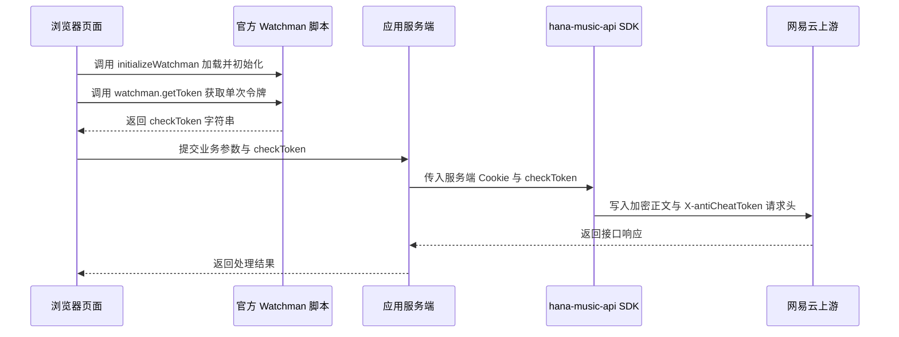

# 浏览器 Watchman 与 checkToken

部分写入或反作弊敏感接口在特定场景下会要求随请求携带易盾 Watchman `checkToken`。应用可在浏览器端通过子路径 `hana-music-api/watchman` 获取单次令牌，再由自己的服务端在调用 SDK 时传入 `checkToken`。

## 端到端工作流程

浏览器子路径仅负责加载官方 Watchman 脚本并取得令牌，不包含任何网易云业务模块、加密算法或账号会话逻辑。



## 浏览器端接入

从 `hana-music-api/watchman` 导入 `initializeWatchman` 与 `WatchmanError`，并在客户端生命周期或用户交互事件中初始化实例与获取令牌。

```ts
import { initializeWatchman, WatchmanError } from 'hana-music-api/watchman';

// 在客户端生命周期（如挂载回调或按钮点击处理）中初始化
const watchman = await initializeWatchman();

async function collectPlaylist(id: number) {
  try {
    const checkToken = await watchman.getToken();
    // 将业务参数与当次 checkToken 提交至应用自己的服务端接口
    await submitCollection({ id, checkToken });
  } catch (error) {
    if (error instanceof WatchmanError) {
      showFailure(error.code);
      return;
    }
    throw error;
  }
}
```

- **页面级实例复用**：同一页面内使用完全相同的配置调用 `initializeWatchman()` 时，会直接复用共享的 Promise 与客户端实例（跨独立打包副本同样生效）。若在初始化进行中或已成功后更换不同配置，调用会以 `configuration` 错误拒绝。
- **每次独立取值**：每次调用 `watchman.getToken()` 都会直接触发官方脚本取新令牌，不做缓存或请求合并。并发呼叫 `getToken()` 会各自等待对应的官方回调。
- **失败清理与重试**：初始化失败时会自动清理脚本节点与内部状态，允许用户在下次主动操作时重新调用 `initializeWatchman()`。`getToken()` 取值失败不会销毁已初始化的实例，也不会在后台自动重试。

## 初始化配置

```ts
const watchman = await initializeWatchman({
  nonce: pageNonce,
  timeoutMs: 10_000,
  tokenTimeoutMs: 10_000,
});
```

| 参数             | 类型                | 默认值                               | 说明                                                   |
| ---------------- | ------------------- | ------------------------------------ | ------------------------------------------------------ |
| `productNumber`  | `string`            | `'YD00000558929251'`                 | 传给官方初始化接口的产品编号                           |
| `protocol`       | `'http' \| 'https'` | `'https'`                            | 传给官方初始化接口的协议标识（脚本加载仍固定为 HTTPS） |
| `businessKey`    | `string`            | `'bd5d2f973ef74cd2a61325a412ae54d9'` | 每次调用官方 `getToken` 时传入的业务标识               |
| `nonce`          | `string`            | `''`（未设置）                       | 为注入的官方 `<script>` 标签设置 CSP `nonce` 属性      |
| `timeoutMs`      | `number`            | `10000`                              | 脚本加载与官方初始化的总超时时间（毫秒）               |
| `tokenTimeoutMs` | `number`            | `10000`                              | 单次调用 `getToken()` 的超时时间（毫秒）               |

- **参数合法性约束**：`productNumber` 与 `businessKey` 不能为空白字符串，`timeoutMs` 与 `tokenTimeoutMs` 必须为大于 `0` 且不超过 `2147483647` 的有限数字。传入的配置会在调用时立即复制，后续修改原对象不会影响初始化与取值。
- **CSP 注意事项**：官方脚本固定从 `https://acstatic-dun.126.net/tool.min.js` 加载（`protocol` 选项不会改为 HTTP）。页面的内容安全策略（CSP）需允许带对应 `nonce` 的脚本以及官方 Watchman 所需的资源与网络请求，来源域名与产品配置仍需符合上游接入条款。
- **Trusted Types 注意事项**：若页面启用了 Trusted Types，须由应用自身的策略放宽并允许该官方脚本 URL。封装不会自行创建放宽策略，脚本源赋值被浏览器拦截时会清理本次状态并返回 `script-load`。

## 错误码与 SSR 边界

- **SSR 安全导入**：Node.js 与服务端渲染环境可安全导入 `hana-music-api/watchman`，子路径类型声明不要求全局 DOM 或 Node 类型，仅在真正执行 `initializeWatchman()` 时才会检测 `window` 与 `document`。
- **前后端入口分离**：根入口 `hana-music-api` 不包含浏览器 Watchman 代码。不要将根入口的业务 SDK 与账号 Cookie 打包进浏览器产物中。

取值或初始化失败均通过 Promise 拒绝并抛出 `WatchmanError` 实例，可通过 `error.code` 区分具体原因：

| 错误码                   | 触发原因                                      | 处理建议                                             |
| ------------------------ | --------------------------------------------- | ---------------------------------------------------- |
| `environment`            | 当前运行环境缺少 `window` 或 `document`       | 确保仅在浏览器客户端生命周期或交互事件中调用         |
| `configuration`          | 参数非法，或与同页已有的初始化配置发生冲突    | 检查参数类型与范围，避免同页混用不同初始化配置       |
| `script-load`            | 官方脚本加载失败或被 CSP / Trusted Types 拦截 | 检查网络连通性、CSP 与策略配置，由用户主动触发重试   |
| `initialization`         | 官方初始化脚本报错、缺少入口函数或实例无效    | 检查页面域名与产品参数配置，稍后允许用户重新初始化   |
| `initialization-timeout` | 加载脚本或等待初始化超出 `timeoutMs`          | 已自动清理本次失败状态，可提示用户检查网络后重试     |
| `token`                  | 官方取值回调抛错、返回空字符串或非字符串值    | 实例仍可继续使用，提示用户重新触发业务操作           |
| `token-timeout`          | 单次取值等待超出 `tokenTimeoutMs`             | 仅结束本次调用等待，不会影响同一页面上的其他并发取值 |

> [!NOTE]
> `WatchmanError` 的错误消息统一为 `Watchman <code>`，不包含官方原始异常堆栈或 token 明文。子路径仅校验返回的令牌是否为非空白字符串，不写死固定字符长度。

## 服务端传递 checkToken

所有标准 SDK 模块均可在第二个参数 `config` 中传入 `checkToken`，支持静态字符串或异步取值函数 `() => Promise<string>`。不传时按原有方式发包，异步函数返回空值或抛错时业务请求会在发送前中止。

```ts
import { createHanaMusicApi } from 'hana-music-api';

const hana = createHanaMusicApi({ cookie: 'MUSIC_U=your-cookie' });

// 单次 API 请求模块可直接传递当次字符串
await hana.albumSub({ id: 32311, t: 1 }, { checkToken });

// 可能触发多次 API 请求的场景使用异步 provider 逐次取新值
await hana.artistSub({ id: 6452, t: 0 }, { checkToken: getFreshCheckToken });
```

- **协议放置位置**：`weapi` 将 `checkToken` 写入加密正文与 `X-antiCheatToken` 请求头，`eapi` 额外写入加密内头 `header['X-antiCheatToken']`。`api` 写入表单正文与请求头，`linuxapi` 写入加密转发正文与请求头，网易云内置直链请求仅设置 `X-antiCheatToken` 请求头（外部上传域名不会收到 token）。
- **字符串复用限制**：静态 `checkToken` 字符串在同一次模块调用中仅允许用于一次 API 请求。若模块内部发起第二次 API 请求，会在准备阶段以 `status: 400` 拒绝，多请求模块须传入异步取值函数逐次获取新值。
- **值格式与安全边界**：`checkToken` 必须是非空且不含首尾空白或非法 HTTP 头字符的字符串，否则在发送前拒绝。携带 token 的请求仅允许发往受信任的 HTTPS 网易云 API 域名，token 不会进入 Cookie、URL 查询参数或 `onRequestEvent` 日志（错误信息中也会脱敏为 `[redacted]`）。
- **缓存与重试禁用**：传入 `checkToken` 会关闭本次调用的响应缓存、并发请求去重与自动重试。等待异步取值函数的耗时计入调用总超时时间 `timeoutMs`。
- **HTTP 服务与底层请求边界**：自建 HTTP 服务接口与底层 `createRequest` 均拒绝通用 `checkToken` 字段（传入返回 `400`）。前后端分离架构应在应用自建的业务路由中接收浏览器令牌，再由服务端调用 SDK 传递，参见 [HTTP 调用约定](/guide/http-conventions)。

## 歌单曲目操作 512 分步取 token

[playlistTracks](/api/playlist/playlist-tracks) 在默认自动模式下，若首次请求返回业务码 `512`，会自动将曲目 ID 列表重复拼接并发送一次后备请求。当应用需要由浏览器在遇到 `512` 后再申请第二枚 `checkToken` 时，可以通过 `step` 参数拆分为两次独立调用：

```ts
import { getNcmFailureInfo, playlistTracks } from 'hana-music-api';

const changeTracks = async (getFreshToken: () => Promise<string>) => {
  const input = { op: 'add' as const, pid: 24381616, tracks: [347231] };
  const config = { cookie: 'MUSIC_U=your-cookie' };

  try {
    return await playlistTracks(
      { ...input, step: 'initial' },
      { ...config, checkToken: await getFreshToken() },
    );
  } catch (error) {
    const failure = getNcmFailureInfo(error);
    if (failure?.kind !== 'business' || failure.code !== 512) {
      throw error;
    }
  }

  return playlistTracks(
    { ...input, step: 'fallback' },
    { ...config, checkToken: await getFreshToken() },
  );
};
```

- **分步执行行为**：传入 `step: 'initial'` 时仅执行首次请求，传入 `step: 'fallback'` 时直接构造后备格式数据并发送一次请求。两步均传入原始 `op`、`pid` 与 `tracks`，SDK 不会修改调用方传入的原数组。
- **前后步骤完全独立**：两步各自独立传入 `cookie`、`state`、`signal` 与 `timeoutMs`，SDK 不合并首次失败返回的 Cookie，也不在步骤之间维持状态或事务回滚。
- **自动模式保持不变**：省略 `step` 时维持原有自动逻辑，若需应对可能的 `512` 重发，请传入异步 `checkToken` provider 逐次取新值。
- **HTTP 服务支持**：自建 HTTP 服务的 `/playlist/tracks` 路由支持业务字段 `step`，但仍不接收通用 `checkToken` 配置，需由应用接口层自行中转，参见 [收藏/取消收藏歌单](/api/playlist/playlist-subscribe) 与 [歌单曲目操作](/api/playlist/playlist-tracks)。
